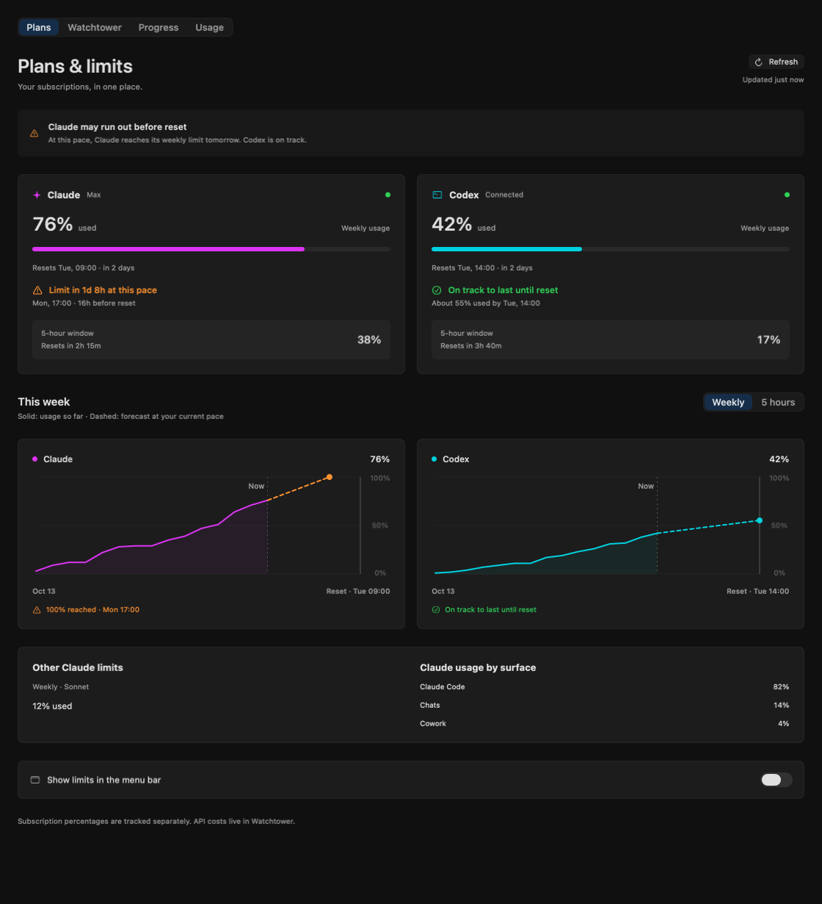
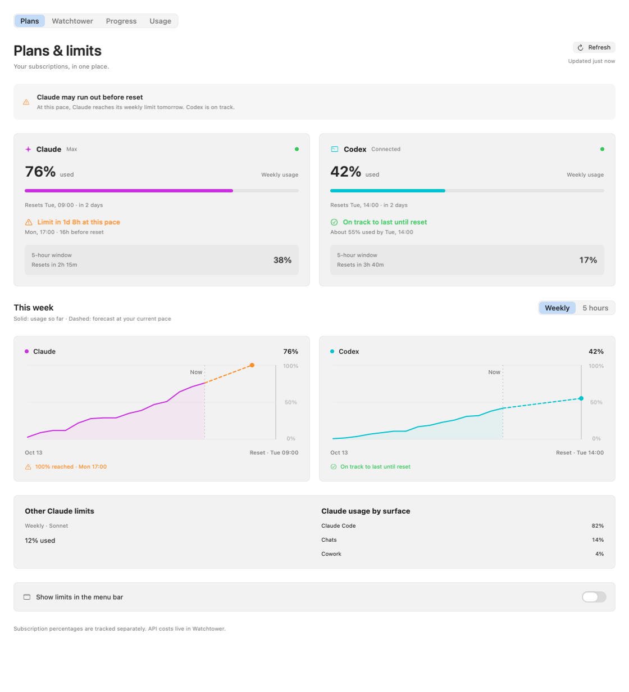
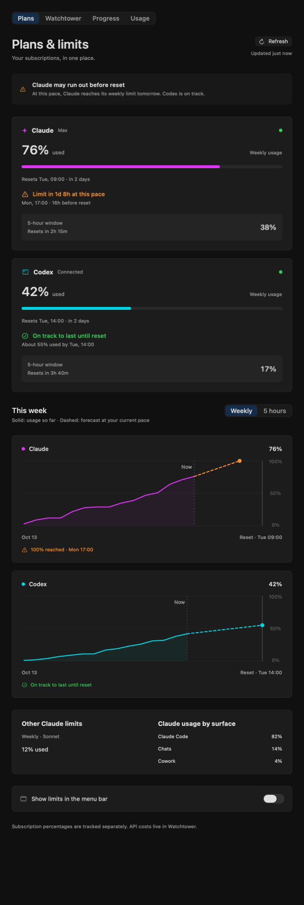

# Plans & limits — макеты

Задача #1470. Предложение дизайна, не реализованный экран. Все цифры вымышленные.

Вместо длинных полос Claude на всю ширину — отдельные карточки Claude и Codex с недельным расходом, пятичасовым окном и временем сброса. Ниже — графики каждой подписки и компактная детализация Claude по моделям и приложениям. На узком экране карточки и графики идут одной колонкой. Выбор Weekly / 5 hours показан как предложение; эти статические макеты изображают недельное окно.

## Прогноз

График продолжается пунктиром от последнего наблюдения до сброса окна. Для Claude показано достижение 100% раньше сброса, для Codex — запас до сброса. Карточка поясняет прогноз словами. При ошибке обновления Codex прогноз не показывается как актуальный. Это демонстрация представления; расчёт должен остаться в Go по существующей политике PlanUsage.

## Макеты

- [Открыть основной макет — тёмная тема](mockups/plans/plans-filled-dark.png).
- [Открыть основной макет — светлая тема](mockups/plans/plans-filled-light.png).
- [Открыть макет узкого окна](mockups/plans/plans-narrow-dark.png).

Остальные состояния:

- [Нет подключённых подписок](mockups/plans/plans-empty-dark.png).
- [Первая загрузка](mockups/plans/plans-loading-dark.png).
- [Обновление с сохранёнными значениями](mockups/plans/plans-busy-dark.png).
- [Ошибка Codex с Retry и отметкой устаревших значений](mockups/plans/plans-error-dark.png).
- [Только одна подключённая подписка](mockups/plans/plans-scoped-dark.png).
- [Codex недоступен, Claude работает](mockups/plans/plans-unavailable-dark.png).

Каждое состояние также сохранено в светлой теме с суффиксом `-light.png`. Макеты зарегистрированы через `PlansShotFixtures.shots` в `DesignShotCatalog`; UI использует DesignKit и Tone. Тексты находятся в `PlansMockupModel`, проверки — в `PlansMockupModelTests`.

## Decisions

- Добавить Codex в статистику и переработать экран; сначала показать макеты — источник: запрос владельца в conversation.
- Визуальное направление принято; добавить отсутствующий прогноз на графики — источник: conversation («норм тока проджекшин не строит»).
- Предложить название Plans вместо Claude plan — решил агент, ожидает согласования.
- Показывать подписки отдельными карточками и графиками, не складывать проценты разных квот — решил агент.
- Сохранять данные работающего провайдера при сбое другого; устаревшие числа обозначать явно — решил агент.
- Сохранить компактную детализацию Claude по моделям и приложениям — решил агент.
- Использовать один столбец при узком окне — решил агент.

## Следующий этап

После согласования визуального направления нужна спецификация реализации: источник реальных лимитов Codex, доступные окна и свежесть данных. Токены вызовов Codex не являются процентом лимита подписки. Прогноз представлен в макетах; его существующая политика расчёта сохраняется и уточняется в спецификации реализации. Подключение провайдеров и переименование вкладки пока лишь предложения дизайна. Контракты PLANUSAGE-01..03 и поведение приложения этим изменением не затрагиваются.
