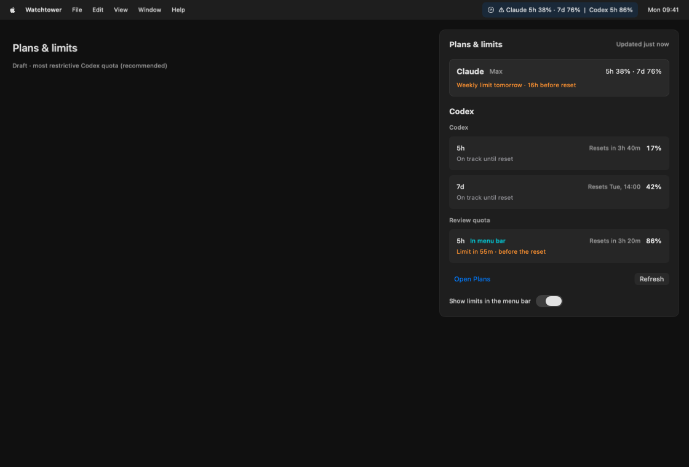
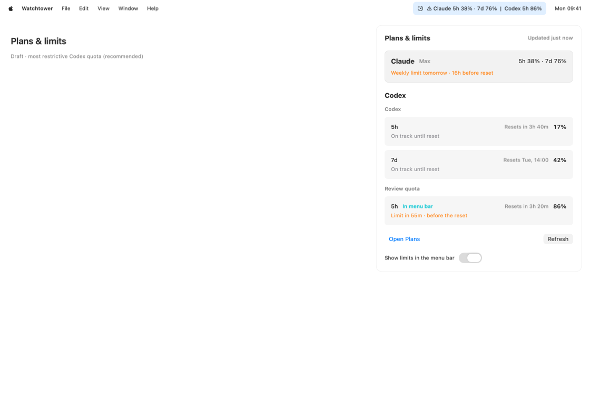
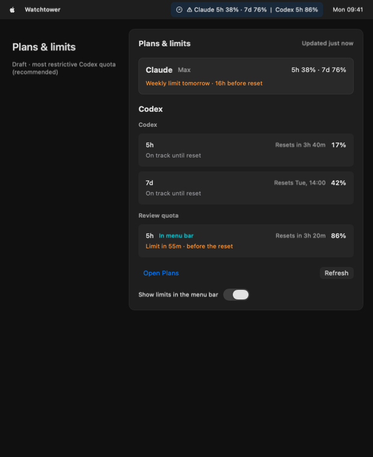
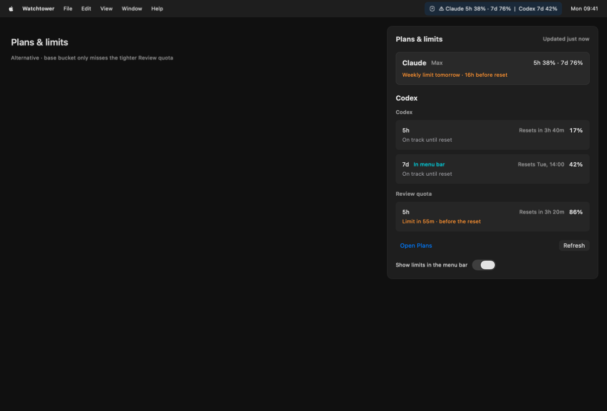
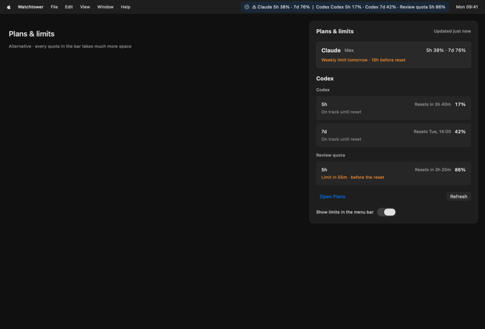

# Plans — меню-бар и раскрытое меню

Задача #1470, замечания раунда 2 ask #926. Объём «Экран и меню-бар» утверждён в ask #925. Ниже на согласование предлагаются **вариант A и его правило выбора квоты**. B и C приведены для сравнения; одобрение этого документа означает принятие A. Все числа вымышленные.

Общая галерея в браузере: http://127.0.0.1:8765/?v=menu-r3#menu-filled . В ней обе темы, узкая строка и состояния загрузки, ошибки с Retry, обновления, отсутствия данных, одной подписки, текущих чисел без истории, устаревания и выключенного текста.

## Вариант A — предлагается к реализации

Claude сохраняет существующие счётчики 5h/7d. Codex показывает одну наиболее ограничивающую квоту **среди всех buckets и окон** с её длительностью и процентом. В раскрытом меню доступны все квоты Codex, включая дополнительные buckets; проценты разных квот не складываются.

Порядок выбора Codex:

1. Лимит уже достигнут: фактический расход ≥100%.
2. Иначе — квота с допустимым прогнозом will_hit и самым ранним hit_at.
3. Иначе — квота с наибольшим текущим процентом расхода.
4. При равенстве — стабильный порядок bucket/limit key.

Прогноз участвует в выборе только после всех согласованных проверок актуальности и identity. Без accountId допустимы только текущие числа успешного ответа, выбор по проценту; прошлые scoped числа и прогноз не используются. Недостоверные/устаревшие Codex значения скрываются. При выключенном тексте остаётся иконка. Системные уведомления остаются только Claude, как согласовано в ask #925.

В примере основная недельная квота Codex использована на 42%, но дополнительная Review quota — на 86% и закончится раньше сброса. Вариант A выводит в строку эту дополнительную квоту; раскрытое меню показывает также основные 5h и 7d.

## Читаемость узкой строки

Цифры счётчиков не обрезаются. Apple/File/Edit в изображении — только контекст макета; он не означает управление меню других приложений.

## Сравнение с альтернативами

B: выбирать только основной bucket. В этом примере строка показывает 42%, а более строгая дополнительная квота остаётся за пределами строки.

C: показывать каждую квоту в строке. Информации больше, но строка существенно длиннее.

## Остальные состояния

- [Нет данных](mockups/plans/plans-menu-empty-dark.png).
- [Загрузка](mockups/plans/plans-menu-loading-dark.png).
- [Ошибка с Retry](mockups/plans/plans-menu-error-dark.png).
- [Обновление](mockups/plans/plans-menu-busy-dark.png).
- [Одна подписка](mockups/plans/plans-menu-scoped-dark.png).
- [Только текущие числа без истории/прогноза](mockups/plans/plans-menu-unknown-id-dark.png).
- [Устаревшие данные](mockups/plans/plans-menu-stale-dark.png).
- [Текст меню-бара выключен](mockups/plans/plans-menu-off-dark.png).

Каждый макет имеет светлую пару `-light.png`. Все зарегистрированы через `PlansShotFixtures.menuShots` в DesignShotCatalog и отрендерены настоящим DesignKit; UI-тексты находятся в fixture model и проверены тестами. Production-код не менялся.

## Decisions

- Экран и меню-бар, без новых Codex notifications — ask #925, принято.
- Вариант A, порядок выбора и внешний вид — предложил агент по замечаниям ask #926; этот документ запрашивает их согласование.
- B/C — только сравнение, не одобренная реализация.
