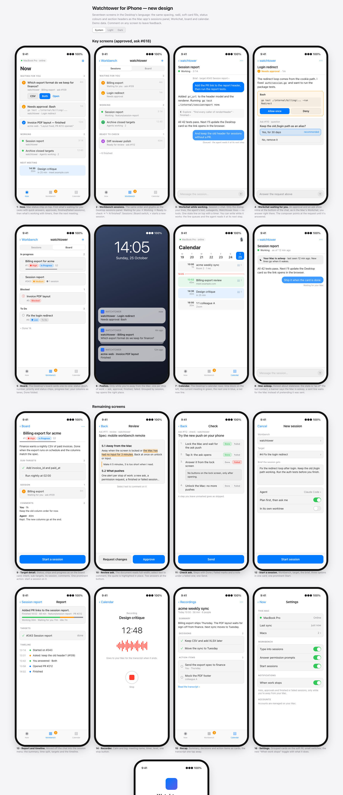
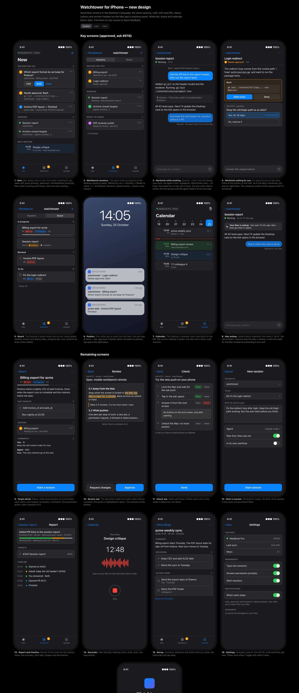

# iPhone redesign — mockups (2026-10-25)

Mockups for board target #1072, spec `docs/superpowers/specs/2026-10-25-mobile-workbench-remote-design.md` §6. Drawn in HTML (`mockups.html`) with the Desktop's tokens (spacing, radii, soft card fills, `Tone` colours, caps section headers) and rendered in both themes. Demo data only.

1. **Now** — Mac status chip on top; Waiting for you (asks with quick answers, approvals, finished/failed sessions), Working with timers, next meeting.
2. **Workbench sessions** — the Desktop sessions panel order and glyphs: Waiting for you → Working → Ready to check → "▸ N finished"; Sessions | Board switch; + starts a session.
3. **Workchat while working** — the session screen is the chat: only the dialog, no tools; one state line with a timer; a line sent while the agent works is queued for its next step.
4. **Workchat waiting for you** — approval card and ask inline at the bottom of the chat, answered in place; the composer points at the request.
5. **Board** — the Desktop's board cards one-to-one, the owner's columns as lanes, Done folded.
6. **Pushes** — only while away from the Mac, one per stop of work, grouped by session.
7. **Calendar** — the Desktop's calendar rows: time block, current meeting green, next blue, now line.
8. **Mac asleep** — state "as of" last contact, a banner, a sent line waits for the Mac.

Screens 1–8 approved (ask #618). Remaining screens, same parts:

9. **Target detail** — status, chips, progress, intent, sub-targets, its session, comments; one action: start a session.
10. **Review ask** — the document full-width, select text to comment, Approve / Request changes.
11. **Check ask** — steps with Done / Failed and a note; Send.
12. **Start a session** — workbench, target, brief, options; Start.
13. **Report and timeline** — reached from the session menu.
14. **Recorder** — name, timer, level, stop.
15. **Recap** — summary, decisions, action items, transcript link.
16. **Settings** — grouped cards, small switches, the new “When work stops” toggle.
17. **Linking** — scan the code on the Mac; help and the demo as quiet links.

Live page: the claude.ai artifact linked from target #1072.
