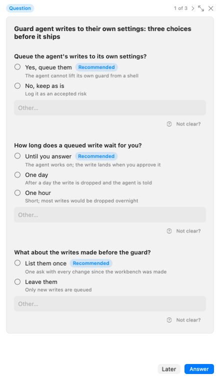
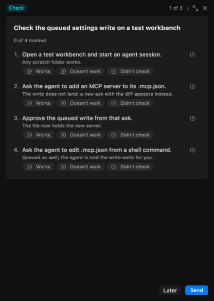
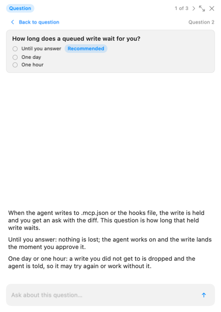
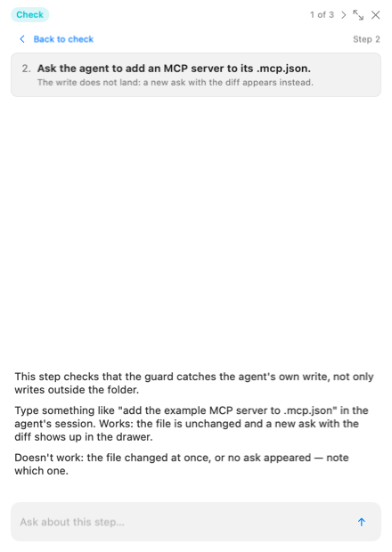
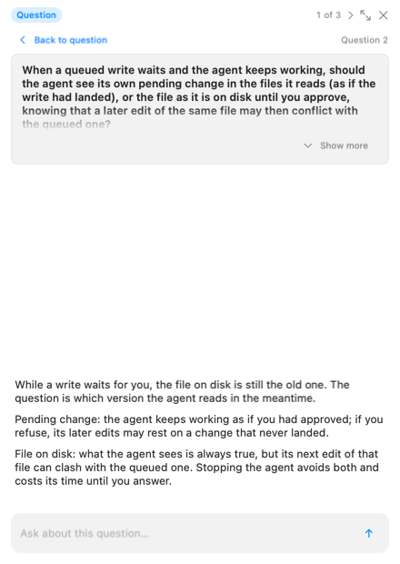
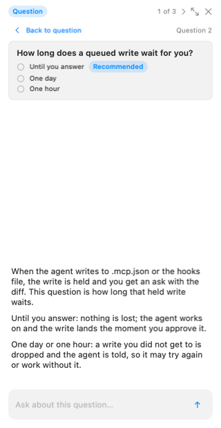
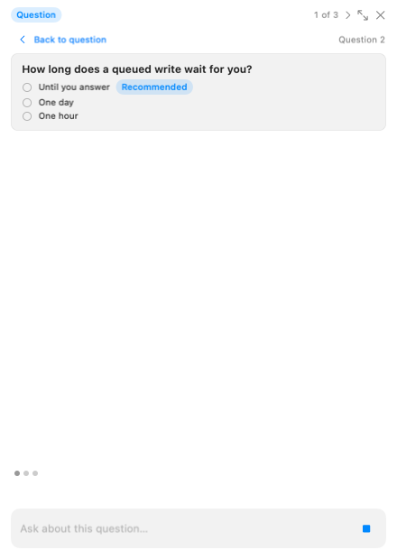
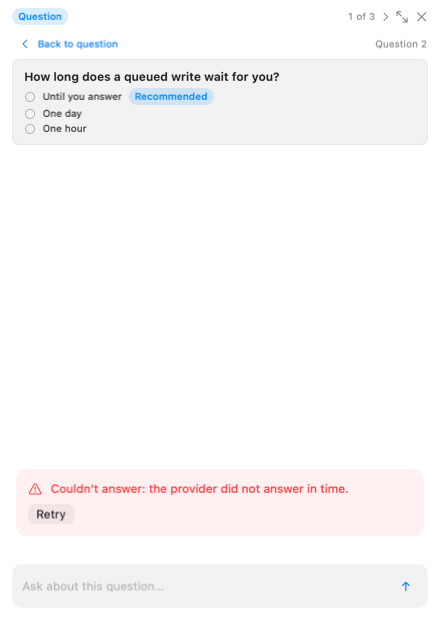

# "Not clear?" on each ask item — mockups

Board #2412, follow-up to the ask-explain chat (#2355). Design-only shots from `DesignShotFixtures+AskExplainItemsMock.swift` (DesignShotCatalog), light and dark.

## What changes

1. **An entry on each item.** Each question of a question ask ends with its own quiet **Not clear?**; each step of a check ask has a small quiet **?** on its row. There is no whole-ask entry any more; an ask with one item shows one entry.
2. **A card on top of the chat.** Under **‹ Back to question** a compact card shows what the chat is about: the question in bold with its options on one line each (Recommended marked, descriptions left out), or the step with its hint. It stays pinned while the chat grows. Past about four lines it fades out with **Show more**.
3. **One chat per item.** Each question or step has its own conversation, explained on first open.

## Entry

| Question ask, three questions | Check ask, four steps |
|---|---|
|  |  |

## Chat

| From question 2 | From a check step | Long question, clamped |
|---|---|---|
|  |  |  |

| Narrow drawer | Loading | Error with Retry |
|---|---|---|
|  |  |  |

Dark versions of every shot sit next to these files (`-dark.png`).

## Open points

- The card leaves out option descriptions to stay short; the assistant's reply explains them.
- **Show more** on a very long question: the expanded card is capped and scrolls inside itself, so the feed keeps its room.
- The strip says "Question 2" / "Step 2" on the right; the ask's title is no longer repeated there (the card shows the item).
