# Background AI consent — mockups for review

Design-only mockups for target #1886 (owner decision: ask #1415). Nothing is built yet.

**Spec:** [background-ai-consent-design](../../../superpowers/specs/2026-11-17-background-ai-consent-design.md).

21 scenes, each in light and dark, registered in `DesignShotCatalog` through `BackgroundAIConsentShotFixtures.shots` (`WatchtowerDesktop/Tests/DesignShots/DesignShotFixtures+BackgroundAIConsent.swift`). Strings: `BackgroundAIConsentMockCopy`, pinned by `BackgroundAIConsentMockCopyTests`. Re-render with `cd WatchtowerDesktop && DESKTOP_SHOTS_DIR=<dir> swift test --filter DesignShotsTests/testBackgroundAIConsentShotsRender`. Sample data only (`acme`).

## The consent screen — onboarding's last step (spec §5)

Claude Code picked:

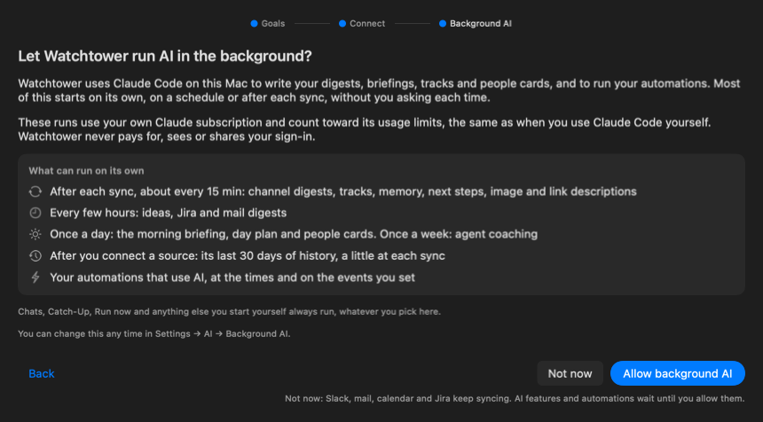

Codex picked, another provider, the automatic reserve on, a 600 pt window:

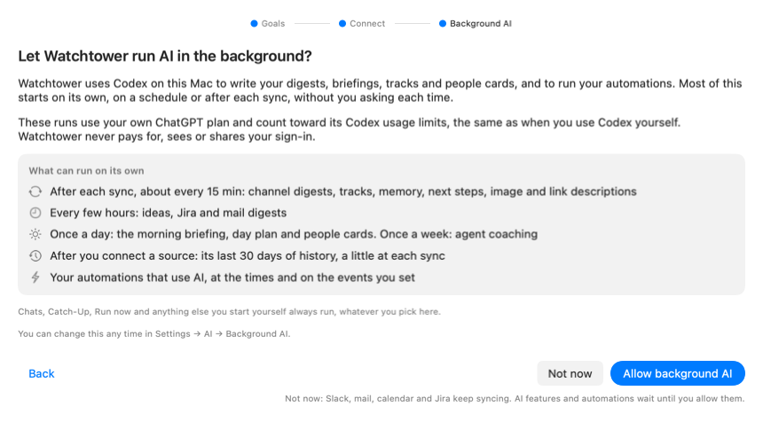

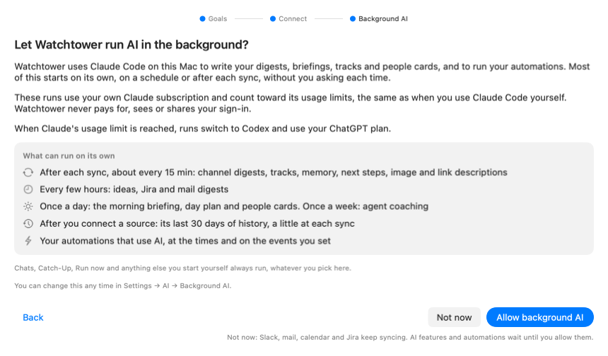
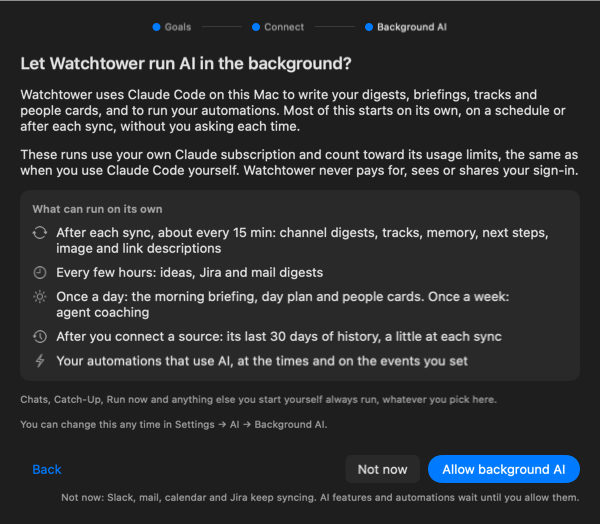

Saving, and a failed write:

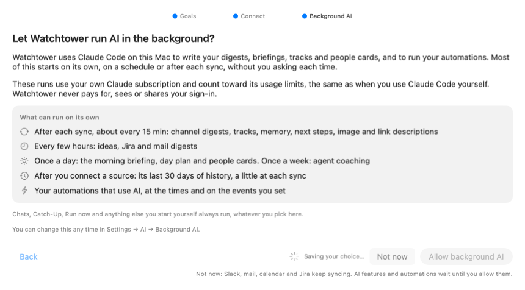
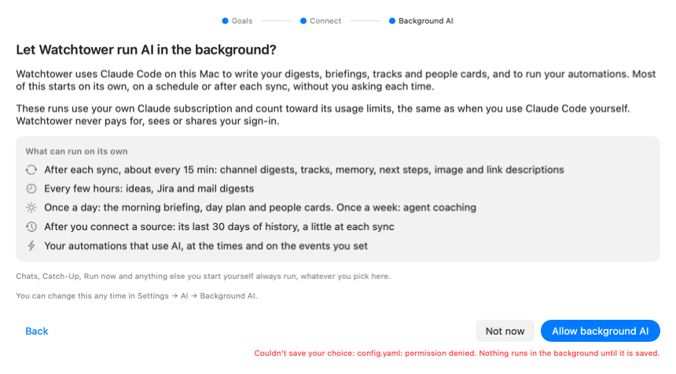

## The one-time sheet after an upgrade (spec §7)

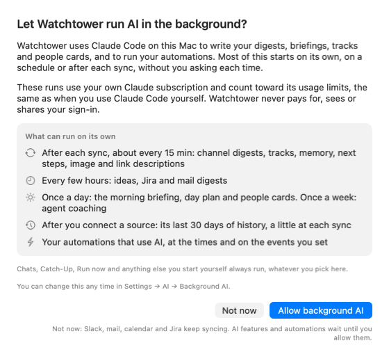
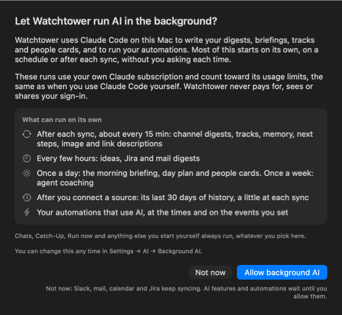
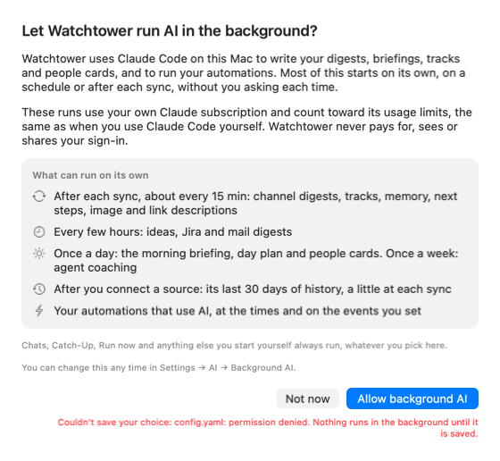

## Settings → AI → Background AI (spec §6.1)

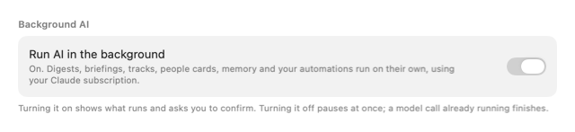
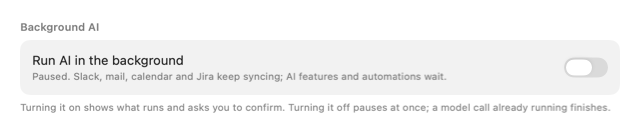
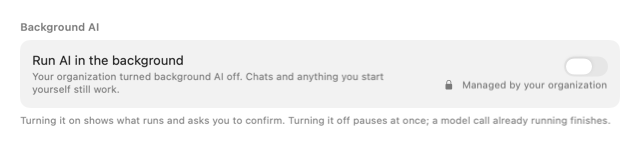
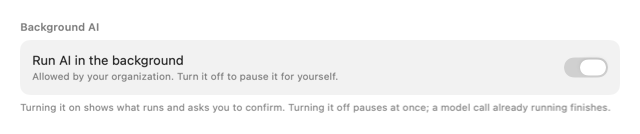
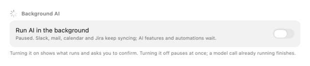
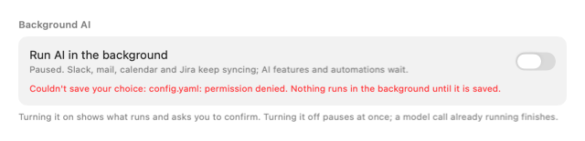

## Home, empty states, Automations (spec §6.2–§6.4)

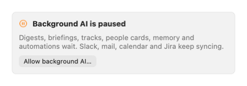
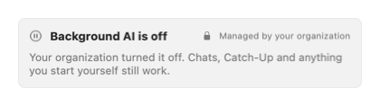
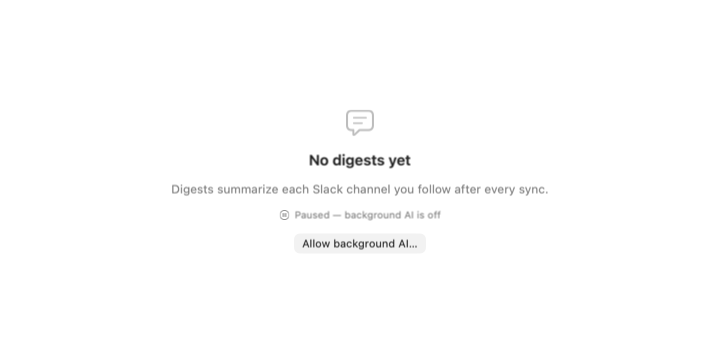
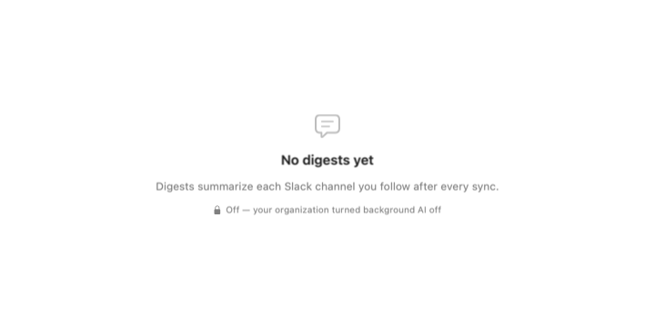
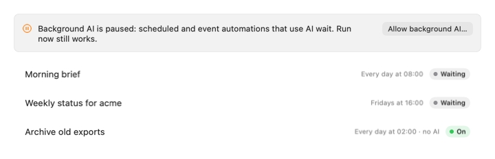
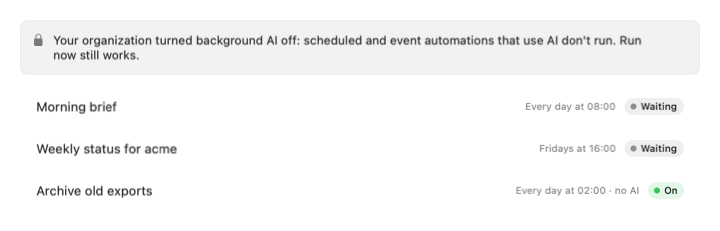
