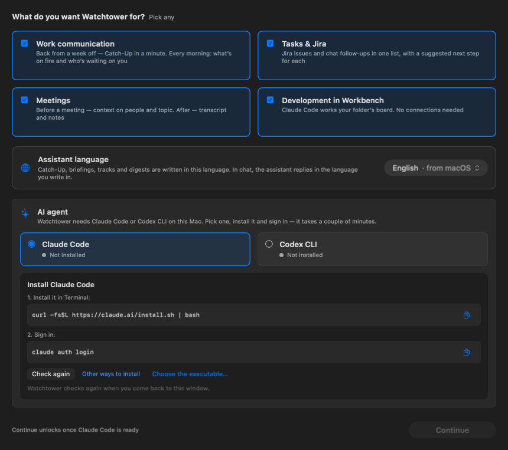
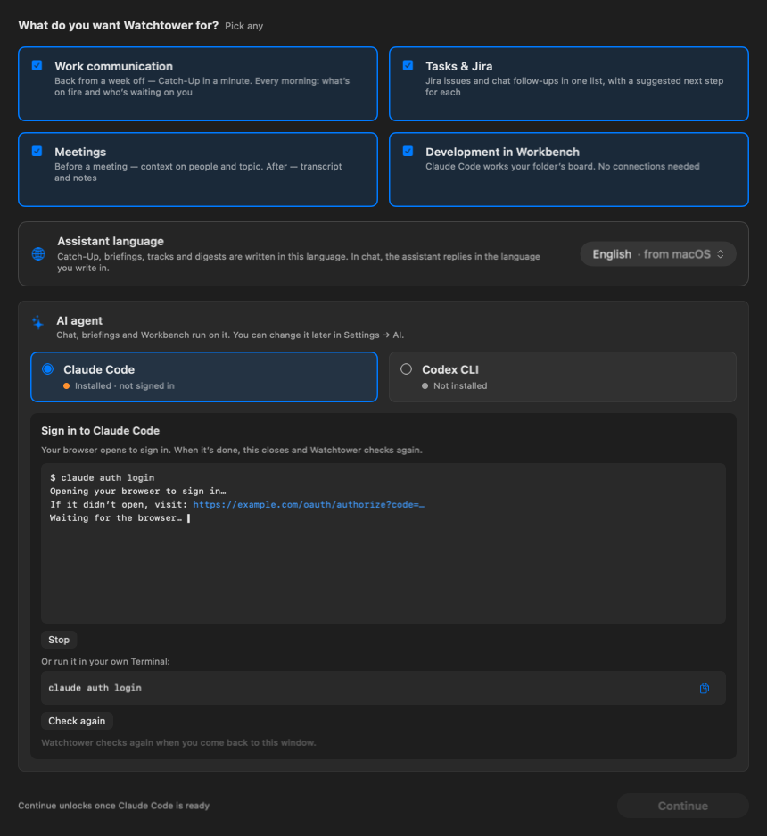
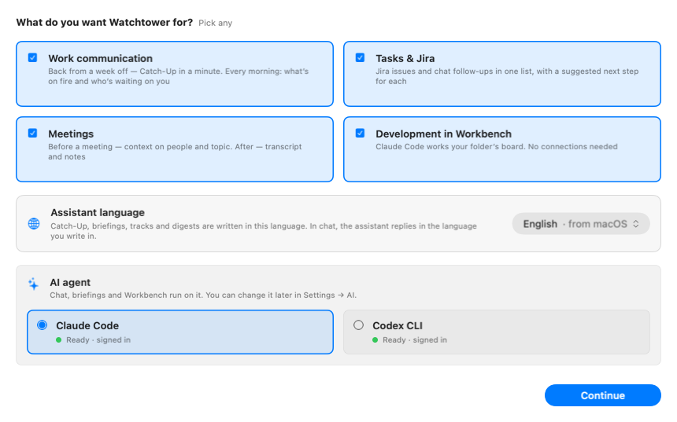

# Onboarding — AI agent choice: mockups

Target #1521. **Spec:** [onboarding-agent-choice-design](../../../superpowers/specs/2026-11-10-onboarding-agent-choice-design.md).

19 scenes rendered from the step's own views (`OnboardingGoalCards`, `AssistantLanguageRow`, `OnboardingAgentSection`, `OnboardingGoalsFooter`) through `OnboardingAgentShotFixtures` in `DesignShotCatalog`; copy from `OnboardingAgentChoice`. Reproduce: `make desktop-shots DESKTOP_SHOTS=docs/design/mockups/onboarding-agent` (or `swift test --filter DesignShotsTests/testOnboardingAgentShotsRender` with `DESKTOP_SHOTS_DIR`).

| Scene | What it shows | Light | Dark |
|---|---|---|---|
| `checking` | Both agents being checked (loading) | [light](onboarding-agent-checking-light.png) | [dark](onboarding-agent-checking-dark.png) |
| `both-ready` | Both ready, Claude preselected | [light](onboarding-agent-both-ready-light.png) | [dark](onboarding-agent-both-ready-dark.png) |
| `both-ready-codex` | Both ready, owner picked Codex | [light](onboarding-agent-both-ready-codex-light.png) | [dark](onboarding-agent-both-ready-codex-dark.png) |
| `only-codex` | Claude missing, Codex ready and preselected | [light](onboarding-agent-only-codex-light.png) | [dark](onboarding-agent-only-codex-dark.png) |
| `signed-out` | Claude signed out: the sign-in terminal runs right in the step (still) | [light](onboarding-agent-signed-out-light.png) | [dark](onboarding-agent-signed-out-dark.png) |
| `signed-out-outdated` | Claude Code too old for `auth login`: updates first in the same terminal | [light](onboarding-agent-signed-out-outdated-light.png) | [dark](onboarding-agent-signed-out-outdated-dark.png) |
| `signed-out-update-failed` | The update failed: "Update stopped…", Update again | [light](onboarding-agent-signed-out-update-failed-light.png) | [dark](onboarding-agent-signed-out-update-failed-dark.png) |
| `signed-out-update-stuck` | The update didn't fix it (another copy on PATH): no loop, path named | [light](onboarding-agent-signed-out-update-stuck-light.png) | [dark](onboarding-agent-signed-out-update-stuck-dark.png) |
| `signed-out-stopped` | Sign-in stopped: warning note, Sign in again | [light](onboarding-agent-signed-out-stopped-light.png) | [dark](onboarding-agent-signed-out-stopped-dark.png) |
| `none` | No agent on the Mac, Claude's install steps | [light](onboarding-agent-none-light.png) | [dark](onboarding-agent-none-dark.png) |
| `none-codex` | No agent, owner picked Codex | [light](onboarding-agent-none-codex-light.png) | [dark](onboarding-agent-none-codex-dark.png) |
| `failed` | Claude's check failed (Failed line + Check again) | [light](onboarding-agent-failed-light.png) | [dark](onboarding-agent-failed-dark.png) |
| `policy` | Organization allows only Codex | [light](onboarding-agent-policy-light.png) | [dark](onboarding-agent-policy-dark.png) |
| `policy-both` | Organization allows neither: Continue waits | [light](onboarding-agent-policy-both-light.png) | [dark](onboarding-agent-policy-both-dark.png) |
| `other-provider` | Provider set to Ollama in Settings (named "Ollama / Local") | [light](onboarding-agent-other-provider-light.png) | [dark](onboarding-agent-other-provider-dark.png) |
| `other-provider-failed` | "Ollama / Local" didn't answer: the tiles come back | [light](onboarding-agent-other-provider-failed-light.png) | [dark](onboarding-agent-other-provider-failed-dark.png) |
| `continuing` | Continue saving (busy) | [light](onboarding-agent-continuing-light.png) | [dark](onboarding-agent-continuing-dark.png) |
| `save-error` | Saving the agent failed | [light](onboarding-agent-save-error-light.png) | [dark](onboarding-agent-save-error-dark.png) |
| `none-narrow` | No agent in a narrow window | [light](onboarding-agent-none-narrow-light.png) | [dark](onboarding-agent-none-narrow-dark.png) |

