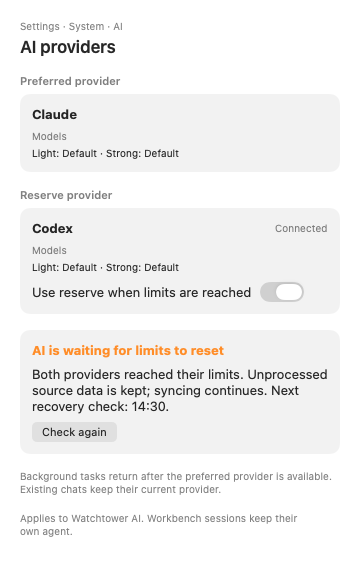
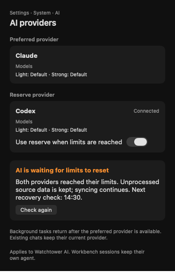
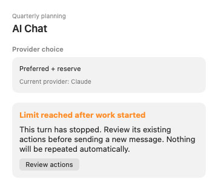
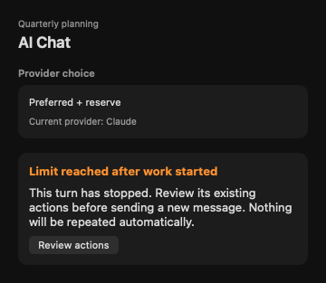
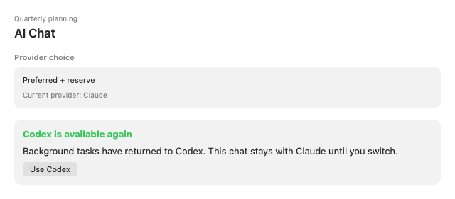

# Provider fallback — макеты для review

Макеты v1 для target #1480; routing ещё не реализован. Ask #937 согласовал направление, sticky recovery, сохранение закрепления старых чатов и безопасные границы первого этапа. Спецификация одобрена в ask #939, план реализации — в ask #940.

**Spec:** [provider-fallback-design](../../../superpowers/specs/2026-11-02-provider-fallback-design.md).

22 сцены зарегистрированы в `DesignShotCatalog` через `ProviderFallbackShotFixtures.shots`. Copy/states — `ProviderFallbackPreview`; semantic tests — `ProviderFallbackPreviewTests`. Панели показывают новые fallback-состояния и summaries существующих model/path controls; существующие editors Settings вне кадра. Данные фиктивные, 14:30 — время fixture.

## Узкие панели

Settings, обе квоты исчерпаны: обещано сохранение исходных данных, не универсальный replay jobs.

Chat после начала работы: ход остановится; кнопка открывает actions, не повторяет prompt.

## Восстановление — решение ask #937

**Одобрено владельцем в ask #937 (recovery):** фон возвращается на preferred, текущий chat остаётся на reserve до явной смены.

## Проверка и воспроизведение

- Получены 44 настоящих SwiftUI PNG: 22 состояния/варианта в light и dark.
- Проверены глазами обе темы узкого Settings и Chat, recovery Codex и busy loading: тексты и кнопки помещаются, разделителей строк нет, используются semantic Tone и indeterminate busy.
- 8 semantic XCTest проверок passed, включая все states и оба направления. Запуск — минимальный временный SwiftPM package с копиями этих Core source/test файлов; product runtime не запускался.
- Render — focused standalone AppKit harness из той же зарегистрированной scene factory, с read-only compiled DesignKit/WatchtowerDesign. Это не запуск полного приложения или всего `DesignShotCatalog.all`.
- В worktree отсутствовал Desktop `.build`; холодный ML build не выполнялся. Первый standalone test build упёрся в sandbox при generate-dSYM; повтор с `-debug-info-format none` прошёл. Готовые PNG и semantic checks не заблокированы.
- Каноническое воспроизведение с готовым Desktop build: `make desktop-shots DESKTOP_SHOTS=docs/design/mockups/provider-fallback`. Команда рендерит весь каталог; эта галерея использует только `provider-fallback-*`. Scenes не запускают CLI/модель и не записывают настройки.

## Все состояния

| Scene | Light | Dark |
|---|---|---|
| `applyError` | [Light](provider-fallback-applyError-light.png) | [Dark](provider-fallback-applyError-dark.png) |
| `applying` | [Light](provider-fallback-applying-light.png) | [Dark](provider-fallback-applying-dark.png) |
| `bothLimited` | [Light](provider-fallback-bothLimited-light.png) | [Dark](provider-fallback-bothLimited-dark.png) |
| `bothLimited-narrow` | [Light](provider-fallback-bothLimited-narrow-light.png) | [Dark](provider-fallback-bothLimited-narrow-dark.png) |
| `checking` | [Light](provider-fallback-checking-light.png) | [Dark](provider-fallback-checking-dark.png) |
| `connectionError` | [Light](provider-fallback-connectionError-light.png) | [Dark](provider-fallback-connectionError-dark.png) |
| `connectionNetworkError` | [Light](provider-fallback-connectionNetworkError-light.png) | [Dark](provider-fallback-connectionNetworkError-dark.png) |
| `empty` | [Light](provider-fallback-empty-light.png) | [Dark](provider-fallback-empty-dark.png) |
| `fallback-codex` | [Light](provider-fallback-fallback-codex-light.png) | [Dark](provider-fallback-fallback-codex-dark.png) |
| `fallback` | [Light](provider-fallback-fallback-light.png) | [Dark](provider-fallback-fallback-dark.png) |
| `notInstalled` | [Light](provider-fallback-notInstalled-light.png) | [Dark](provider-fallback-notInstalled-dark.png) |
| `notVerified` | [Light](provider-fallback-notVerified-light.png) | [Dark](provider-fallback-notVerified-dark.png) |
| `pinned` | [Light](provider-fallback-pinned-light.png) | [Dark](provider-fallback-pinned-dark.png) |
| `policy` | [Light](provider-fallback-policy-light.png) | [Dark](provider-fallback-policy-dark.png) |
| `probing` | [Light](provider-fallback-probing-light.png) | [Dark](provider-fallback-probing-dark.png) |
| `ready-codex` | [Light](provider-fallback-ready-codex-light.png) | [Dark](provider-fallback-ready-codex-dark.png) |
| `ready` | [Light](provider-fallback-ready-light.png) | [Dark](provider-fallback-ready-dark.png) |
| `recovered-codex` | [Light](provider-fallback-recovered-codex-light.png) | [Dark](provider-fallback-recovered-codex-dark.png) |
| `recovered` | [Light](provider-fallback-recovered-light.png) | [Dark](provider-fallback-recovered-dark.png) |
| `stopped` | [Light](provider-fallback-stopped-light.png) | [Dark](provider-fallback-stopped-dark.png) |
| `stopped-narrow` | [Light](provider-fallback-stopped-narrow-light.png) | [Dark](provider-fallback-stopped-narrow-dark.png) |
| `unsupported` | [Light](provider-fallback-unsupported-light.png) | [Dark](provider-fallback-unsupported-dark.png) |
