# Report a Problem — mockups (target #1527)

**Spec:** [report-a-problem-design](../../../superpowers/specs/2026-11-04-report-a-problem-design.md).

Real SwiftUI renders of `ReportProblemShotFixtures` (`WatchtowerDesktop/Tests/DesignShots/DesignShotFixtures+ReportProblem.swift`), registered in `DesignShotCatalog`. Design-only: not wired into the app, sample data only (no live install). The strings are the spec's string table.

| State | Light | Dark |
|---|---|---|
| Collecting (loading, busy) | 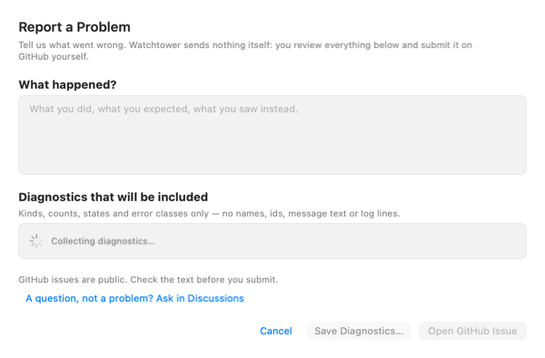 | 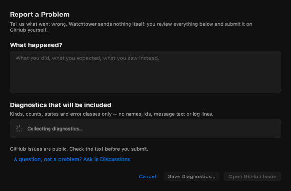 |
| Ready, nothing typed (empty) | 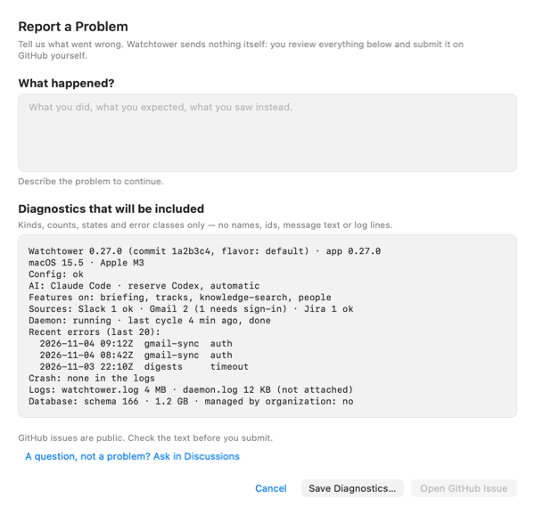 | 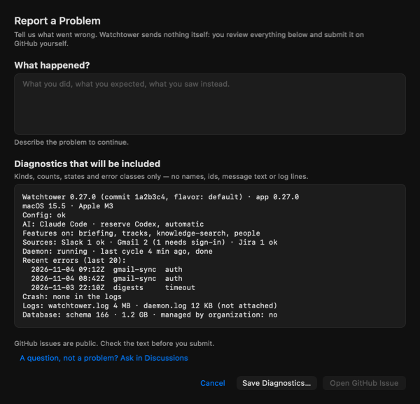 |
| Ready, typed | 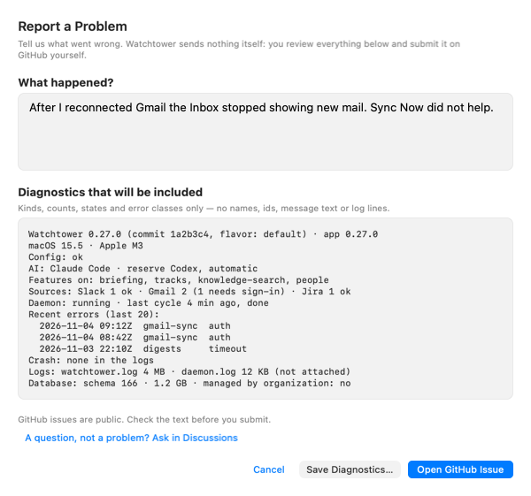 | 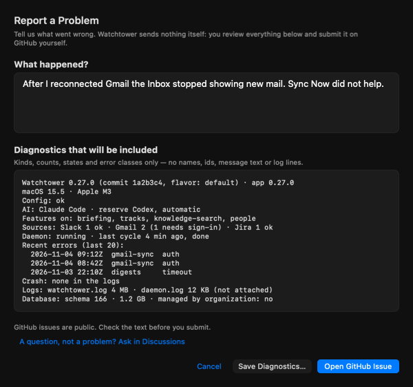 |
| Database busy (lines with `unknown (database busy)`) | 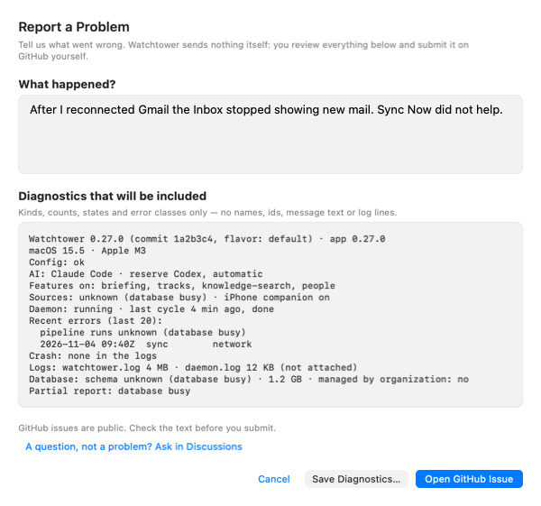 | 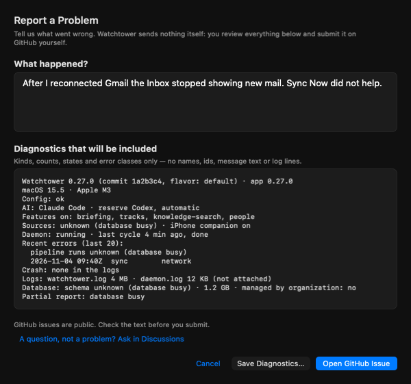 |
| Diagnostics failed, Retry (error) | 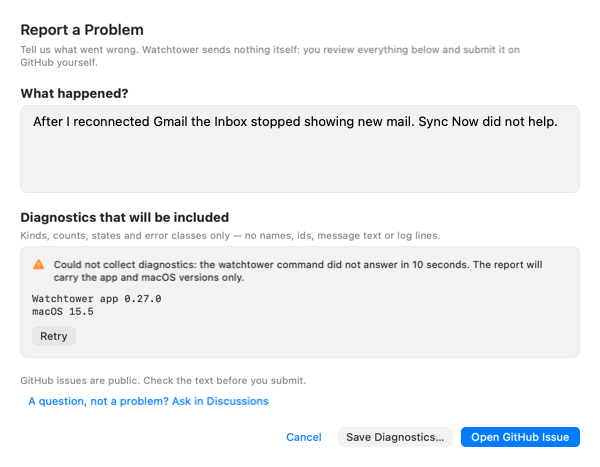 | 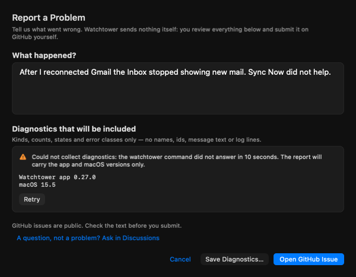 |
| Opened, sheet stays | 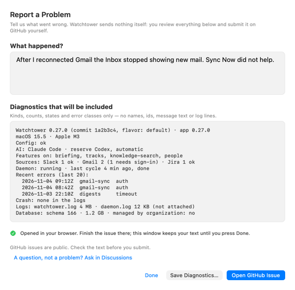 | 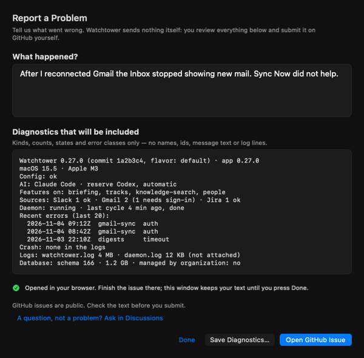 |
| Link too long, Copy Report | 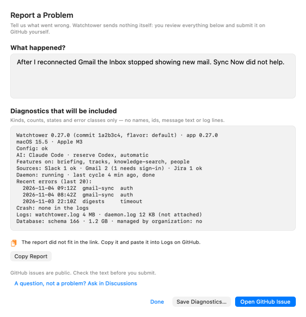 | 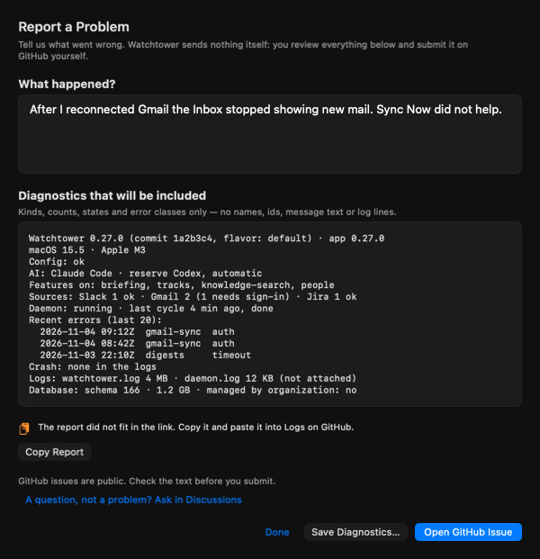 |
| Browser did not open, Copy Link |  | 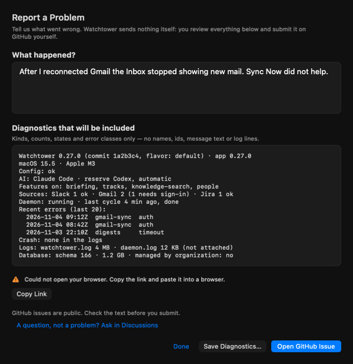 |
| Save failed | 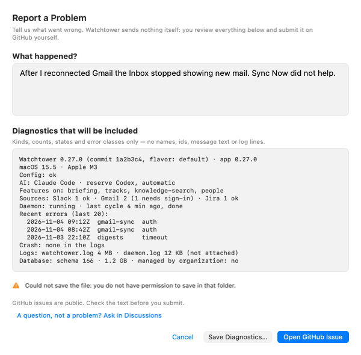 | 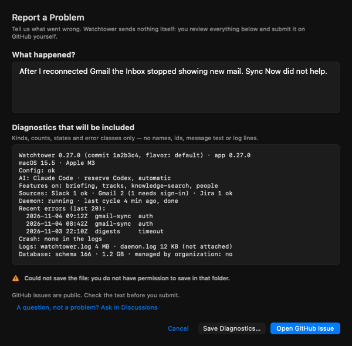 |
| Corporate build, Save only | 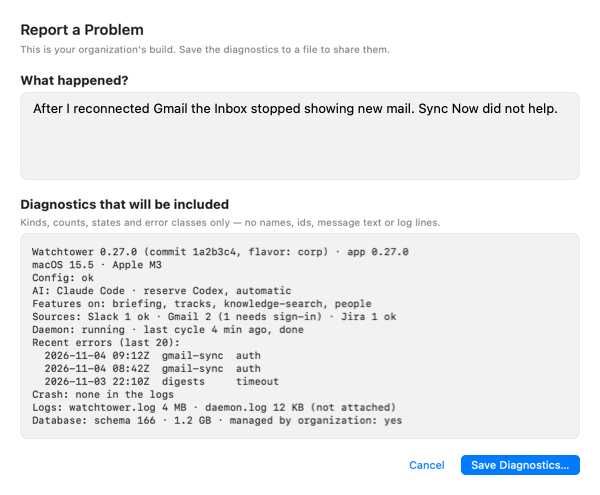 | 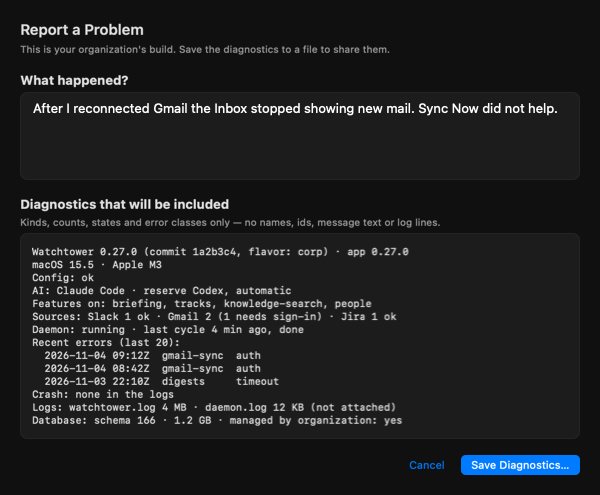 |
| Narrow (360 pt) | 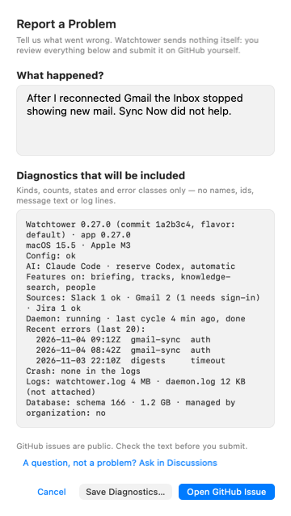 | 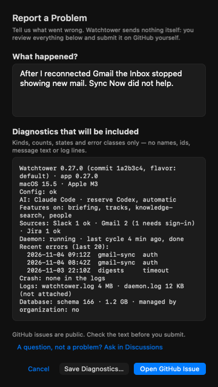 |
| Settings → System → Logs entry | 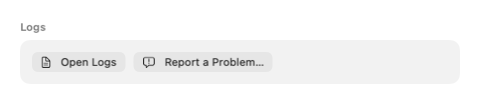 | 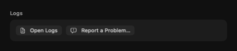 |

Re-render: `cd WatchtowerDesktop && DESKTOP_SHOTS_DIR=<dir> swift test --filter DesignShotsTests/testReportProblemShotsRender`.
