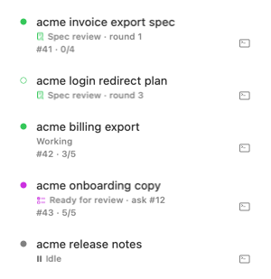
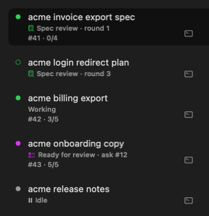
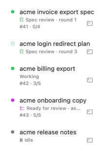
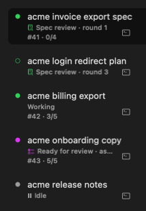
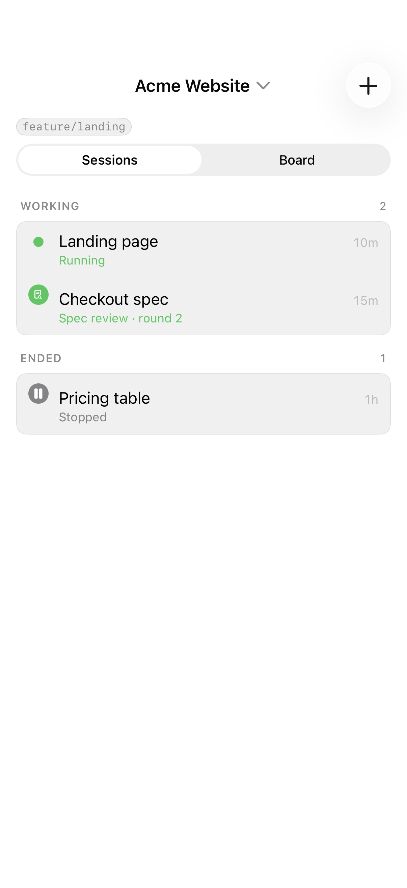

# Session state during a spec review (screens on fixtures)

Spec: `docs/superpowers/specs/2026-11-18-session-spec-review-state-design.md` (board #1945, decisions in asks #1492 and #1497). Rendered by `make desktop-shots` from `DesignShotFixtures+SpecReviewState.swift`; sample data only.

Sessions panel rows: Spec review · round 1 (live, selected), Spec review · round 3 (not live, ring), then Working, Ready for review and Idle for contrast.

Narrow panel (190 pt): captions truncate, dot and glyph stay.

iPhone Sessions tab (`make mobile-shots SHOTS_ONLY=spec-review`): the session under Working, green magnifier, "Spec review · round 2".

