# Spec review — summary, Discuss threads, per-kind buttons (screens on fixtures)

Spec: `docs/superpowers/specs/2026-11-08-spec-review-discuss-design.md`. Rendered by `make desktop-shots` from fixtures (sample data only); light theme. The logic is not wired yet: these screens are for the owner's review before Tasks 13–15.

## The summary — first screen of the review

The brief, then the theses by kind; Goal and Risk opened (the quoted passage, **Read the spec**, **Discuss**), a thread open on the Risk thesis.

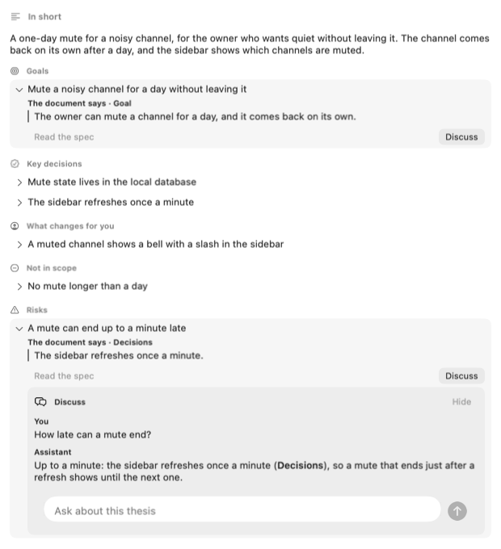

The Meaning step with the summary leading (folded), then the idea, the Decisions list and the counts.

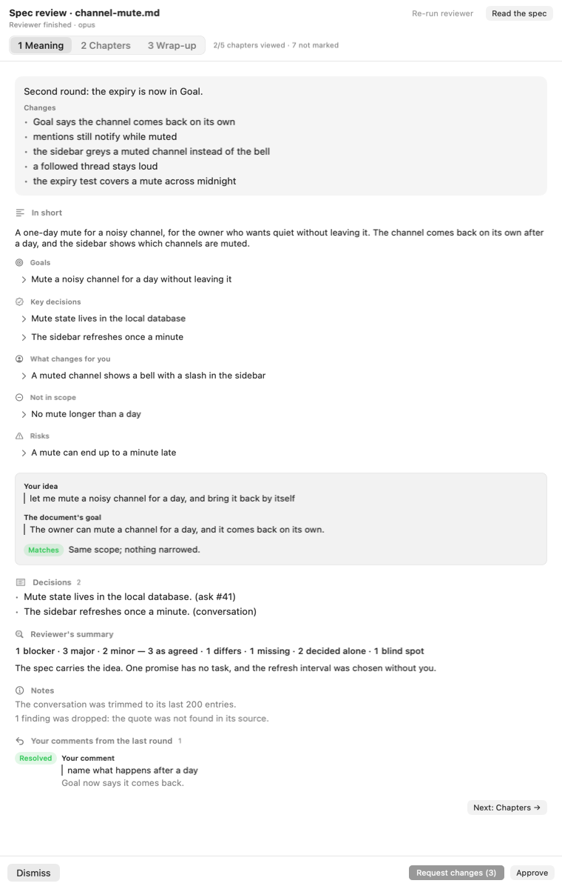

## Buttons by card kind

As agreed (Discuss, Not useful); an actionable finding (Fix, Skip, Discuss, Not useful); a check to verify (Discuss, Checked); a finding added from a discussion (chip **From discussion**); a thesis (Discuss).

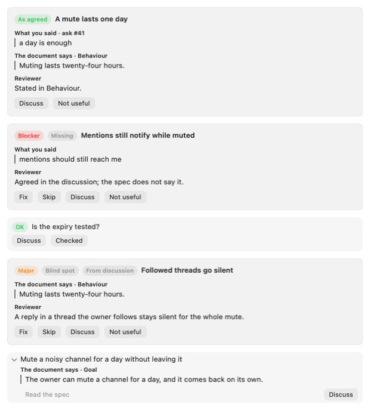

Loop cards: a dispute (Reviewer is right, Author is right, Discuss), not answered by the author (Fix, Skip, Discuss), fixed by the author (Reopen, Discuss).

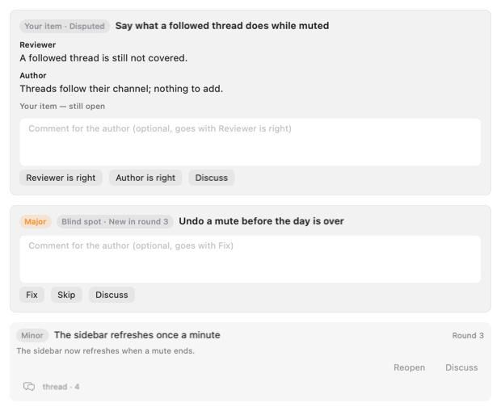

A chapter with Discuss on every card, a folded thread, a picked Fix with **Add Comment**, a check marked **Checked**.

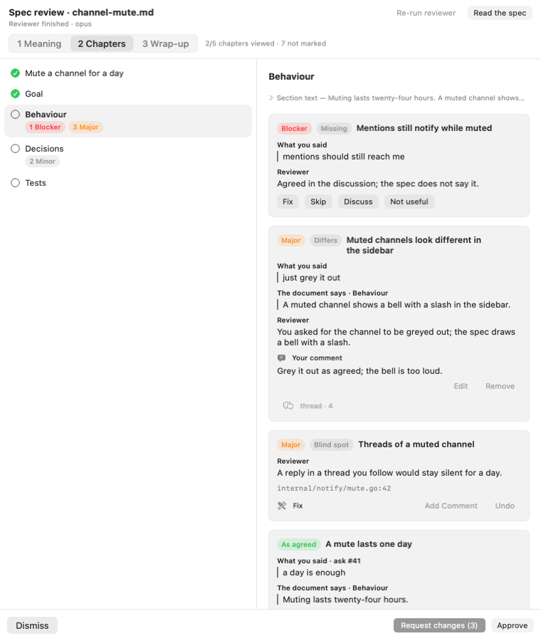

## A Discuss thread

Open on a finding: the owner's question, the assistant's answer, the composer.

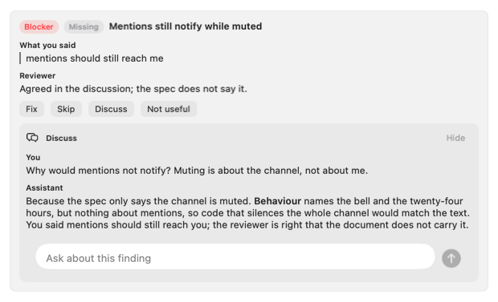

Folded: the card shows "thread · N".

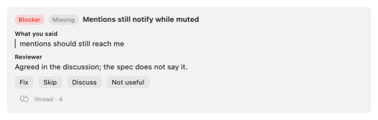

Asking the author: pending, answered, and the author did not answer.

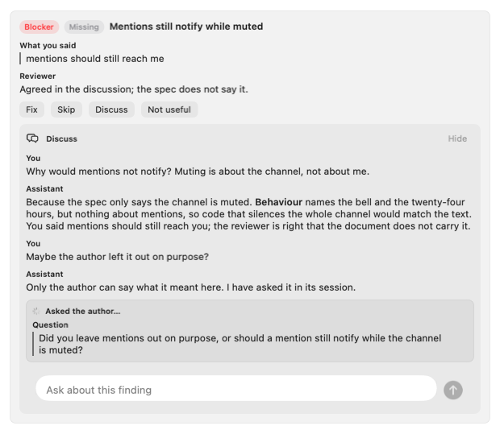

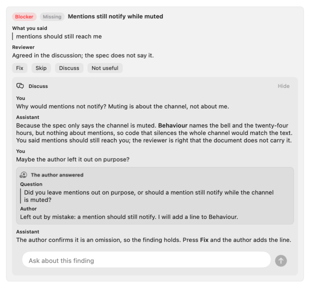

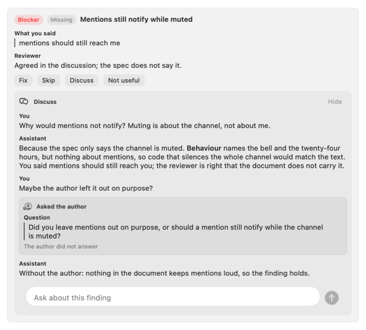

A finding proposed in the thread: **Add to review**, and the same card refused ("not added: quote not found").

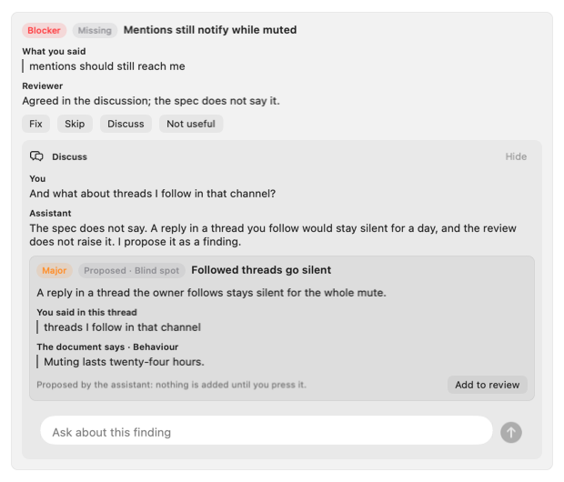

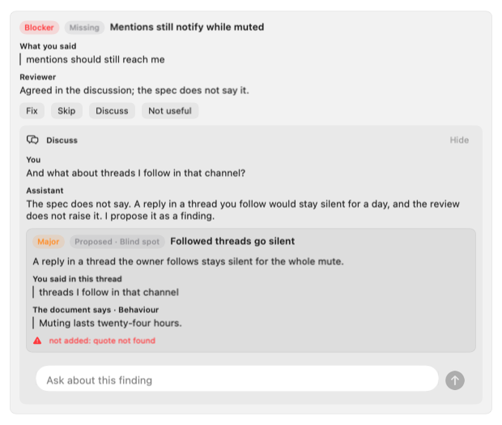

## The loop's end lines

Stalled, with the owner's own items from Request changes ("Your item — still open" / "Your item — fixed by the author").

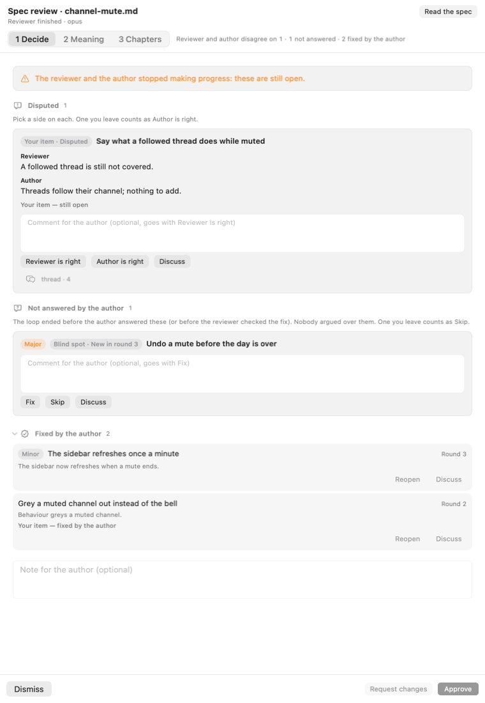

The fuse at round 8.

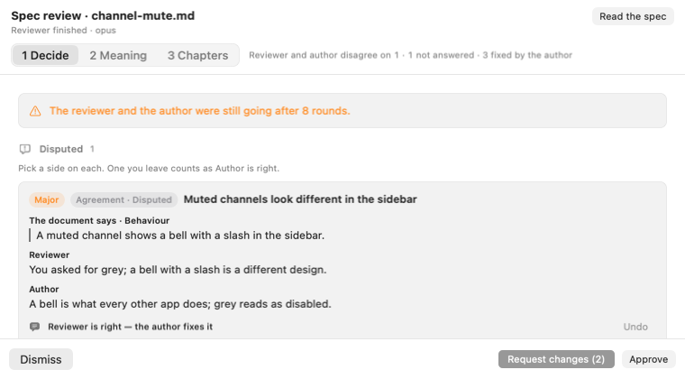
