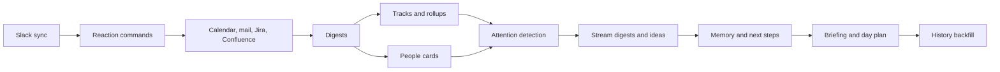

# How Watchtower works

Watchtower copies your work into a database on your Mac, then a background sync turns it into summaries, plans and an inbox. Most of what you see is not made when you open a tab. It is prepared on a schedule, which is why a new tab can be empty.

## The three layers

1. **Sources** are the accounts you connect: Slack, Google, mail, calendars, Jira. See [Sources and accounts](sources-and-accounts.md).
2. **A local database** holds a copy of what the sources return, on your Mac only. The app and the command-line tool both read it.
3. **Pipelines** are AI and mechanical jobs that read the database and write results back: digests, tracks, briefings and so on. Tabs show those results.

The AI runs through the Claude Code or Codex command-line tool (or a local server); see [AI providers, models and cost](ai-providers-and-cost.md).

## What one sync cycle does

A small background program, the daemon, runs a cycle every 15 minutes (**Settings → System → Sync → Poll Interval**). A cycle also starts when the daemon starts, when the Mac wakes from sleep, and when you press **Sync Now** in the menu bar. The daemon keeps running when you close the window and stops when you quit the app.

Each step runs only if its feature is on and its source is connected. A step that has nothing to do writes nothing, which is why some tabs stay quiet. If the Slack sync fails, the later steps still run on the data already stored.

## What runs when

Times are local. "Every cycle" means every 15 minutes by default.

| Output | When | Needs |
|---|---|---|
| Slack messages | Every cycle | Slack workspace connected and enabled |
| Reaction commands | Every cycle, right after the Slack sync | Slack; Reaction Commands on (on by default) |
| Calendar events, mail | Every cycle | An account connected; calendar and Gmail sync on (on by default) |
| Jira issues | Every cycle, at most every 15 minutes (own interval) | A Jira site connected |
| Linear issues | Same as Jira | A Linear account connected with `watchtower linear add` |
| Confluence pages | Every cycle | A space picked; Confluence in search on |
| Channel digests | Every cycle, for channels with new messages | Slack Digests on |
| Daily and weekly rollups | Every cycle, once there are new digests (at least two channels); gives up after 3 failed tries a day | Slack Digests on |
| Tracks | Every cycle | Tracks and Slack Digests on |
| People cards | At most once every 24 hours | People Cards and Slack Digests on |
| Attention detection (no AI) | Every cycle | Attention detection on; Watchtower knows who you are |
| Stream digests (mail and Jira) | Every 6 hours | Stream Digests on; Gmail or Jira connected |
| Ideas & Decisions | Every 6 hours (**Settings → Features → Ideas → Mining interval**, 1 to 48) | Ideas on |
| Memory | Every cycle; waits while history backfill runs | Memory on (off by default) |
| Next-step suggestions | Every cycle, for targets with none or a stale one | Next Step Suggestions on |
| Briefing | Once a day, at or after 08:00 (**Briefing Hour**) | Briefing on; Watchtower knows who you are |
| Day plan | Once a day, at or after 08:00 (**Generate at hour**); conflicts are re-checked every cycle after | Day Plan on; Watchtower knows who you are |
| History backfill | After everything else, while a new source is loading | A newly connected source |
| Search index | Every cycle, in slices of up to 60 seconds | Knowledge search on (on by default) |
| Agent analytics | Every cycle | A Workbench with agent analytics enabled |
| Snoozed items coming back | Every cycle | Nothing |
| Meeting-audio cleanup | Every cycle | Recordings older than 30 days lose their audio; transcripts stay |
| Claude plan limits | Own poller, every 5 minutes | Claude Code signed in; Claude plan limits on |
| Automations | Own scheduler, per recipe | Automations on; a confirmed recipe |

Two exceptions to the daily hour: on a brand-new install the first briefing and the first day plan are made in the first cycle that can make them, without waiting for 08:00. And if a daily job fails three times in one day it waits until tomorrow.

Catch Up, the chat, meeting notes and Workbench sessions are not scheduled. They run when you ask.

## Related

- [Turning features on and off](features-on-and-off.md): the switches behind this table.
- [Why a tab is empty](features-on-and-off.md#why-a-tab-is-empty-and-what-its-status-line-means)
- [Troubleshooting](../troubleshooting/README.md)

For developers: [docs/features/tray-daemon-lifecycle.md](../../features/tray-daemon-lifecycle.md), [docs/features/first-run.md](../../features/first-run.md)
