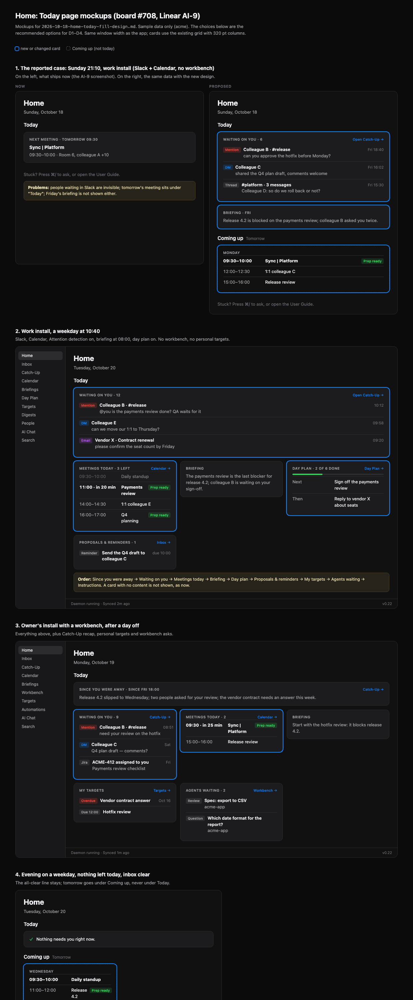

# Home Today — what belongs there (board #708, Linear AI-9)

**Status:** design for owner review. Builds on
`docs/superpowers/specs/2026-10-14-first-run-home-design.md` §3.2 and the
shipped P2 (`docs/features/first-run.md`, "Home (Desktop, P2)").

## 1. What the owner saw

On a work install (Slack + Google Calendar, no workbench bound, no
personal targets) on a Sunday evening, Home showed one card under the
**Today** header: "NEXT MEETING · TOMORROW 09:30". The page was otherwise
empty, and a tomorrow meeting under a "Today" heading reads as a wrong
date.

## 2. Why it is empty

Every Today card shows only with content (spec §3.2). On that install:

| Card | Why it did not show |
|---|---|
| Since you were away | Only an *unacknowledged ready* Catch-Up recap. A recap is built after an absence; an owner who uses the app daily rarely has one. |
| Waiting on you | Counts only agent proposals (pending/failed) and due reminders — the Inbox tab's action strip (planning resolution 9). Pending **mentions, DMs and thread replies** (`inbox_items`, attention detection) are not counted. A work install has a large pending `inbox_items` backlog and zero proposals, so the card never shows. |
| Briefing | Today's briefing row only; none exists before the morning run, and none on a day the run was skipped. |
| My targets | Personal targets due ≤ today or in progress; a new user has none. |
| Agents waiting | Workbench asks; no workbench on a work install. |
| Instructions | Workbench-only signal. |

Root cause: the one signal a work install has in abundance — people
waiting on the owner in Slack/mail — has **no path to Home**.
`inbox_items` has no screen of its own since the 2026-09-14 demolition;
it reaches the owner only through Catch-Up (after an absence) and the
briefing's inbox block (once a day). The original spec's "who is waiting
for you" line meant these people; the planning resolution narrowed it to
the action strip.

## 3. Why the tile is "wrong"

The builder is correct — it says TOMORROW. The defect is the page:
the section header is **Today** and the 24 h horizon lets tomorrow's
first meeting in. Evening and weekend views always hit this.

## 4. Proposal

Keep Home a read-only page of links into tabs (no AI, no writes, no new
pipeline). Changes, in order of value:

### 4.1 People waiting on you (new card, the main fix)

- Source: pending, non-snoozed `inbox_items` (attention detection), the
  same rows Catch-Up's `needs_you` reads, newest by
  `MAX(created_at, mentioned_at)`. High priority first.
- Card: "WAITING ON YOU · N" with the top 3: sender(s), channel/subject,
  one line of text, chip = trigger (Mention / DM / Thread / Email / Jira).
- Click on an item: open the source (Slack permalink / mail) — the same
  **Open** link `InboxItemInline` already has; the header opens Catch-Up
  (the only screen listing these items).
- The existing proposals/reminders card is renamed **"Proposals &
  reminders"** (or folded in as chips — decision D1).
- Gate: shows while attention detection (`secretary-inbox`) is on.
- Cap on noise: only items from the last 7 days (decision D2), so an old
  backlog does not turn into a permanent "N = hundreds".

### 4.2 Today's meetings instead of "Next meeting"

- The calendar card lists **today's remaining meetings** (up to 4: time,
  title, "Prep ready"), the next one first and highlighted.
- When nothing is left today, the card is titled **"Tomorrow"** and moves
  out of the Today header into a small **Coming up** section below (or is
  hidden — decision D3). Fixes §3 by construction.

### 4.3 Briefing fallback

- Before today's briefing exists, show the latest one with its date
  ("BRIEFING · FRI") until today's lands, or a one-line "Today's
  briefing at 08:00" from `FeatureReadiness`' `Eta` (decision D4).

### 4.4 Day plan (if on)

- If day plans are enabled and today's plan exists: "DAY PLAN · 3 of 7
  done" with the next 3 open items; click → Day Plan. Read-only.

### Not proposed

Tracks, digests and people cards stay off Home: they are reading
material, not "needs you now", and would turn Home into the retired
Dashboard.

## 4a. Mockups

Full-fidelity mockups (dark theme, the app's card grid, sample data):
`2026-10-18-home-today-mockups.html` (open in Files → **Preview**) and its
render `2026-10-18-home-today-mockups.png`. Four screens: the reported
case before/after, a work install on a weekday, the owner's install after
a day off, and the evening all-clear. They show the recommended D1–D4.



The same screens as sketches:

**1. The reported case — Sunday 21:10, work install (now → proposed)**

```
NOW                                   PROPOSED
Home                                  Home
Sunday, October 18                    Sunday, October 18

Today                                 Today
┌──────────────────────────────┐      ┌──────────────────────────────────────┐
│ NEXT MEETING · TOMORROW 09:30│      │ WAITING ON YOU · 6    Open Catch-Up →│
│ Sync | Platform              │      │ [Mention] Colleague B · #release     │
│ 09:30–10:00 · Room 6, A +10  │      │   can you approve the hotfix…  Fri   │
└──────────────────────────────┘      │ [DM] Colleague C                     │
                                      │   shared the Q4 plan draft…    Fri   │
                                      │ [Thread] #platform · 3 messages      │
                                      │   Colleague D: so do we roll…  Fri   │
                                      └──────────────────────────────────────┘
                                      ┌──────────────────────────────┐
                                      │ BRIEFING · FRI               │
                                      │ Release 4.2 is blocked on…   │
                                      └──────────────────────────────┘
                                      Coming up  Tomorrow
                                      ┌ ─ ─ ─ ─ ─ ─ ─ ─ ─ ─ ─ ─ ─ ─ ─┐
                                        MONDAY
                                      │ 09:30–10:00 Sync | Platform  [Prep ready]
                                        12:00–12:30 1:1 colleague C  │
                                      │ 15:00–16:00 Release review
                                      └ ─ ─ ─ ─ ─ ─ ─ ─ ─ ─ ─ ─ ─ ─ ─┘
```

**2. Work install, weekday 10:40**

```
Today
┌──────────────────────────────────────────────────────────────────────┐
│ WAITING ON YOU · 12                                  Open Catch-Up → │
│ [Mention] Colleague B · #release  is the payments review done?  10:12│
│ [DM]      Colleague E             can we move our 1:1 to Thu?   09:58│
│ [Email]   Vendor X · Contract     confirm the seat count        09:20│
└──────────────────────────────────────────────────────────────────────┘
┌──────────────────────────┐ ┌──────────────────────┐ ┌──────────────────────┐
│ MEETINGS TODAY · 3 left  │ │ BRIEFING             │ │ DAY PLAN · 2 of 6    │
│ 09:30 Daily standup (dim)│ │ The payments review  │ │ ▓▓▓░░░░░░            │
│▶11:00 in 20 min Payments │ │ is the last blocker… │ │ Next: Sign off the   │
│       review [Prep ready]│ └──────────────────────┘ │   payments review    │
│ 14:00 1:1 colleague E    │                          │ Then: Reply to X     │
│ 16:00 Q4 planning [Prep] │                          └──────────────────────┘
└──────────────────────────┘
┌──────────────────────────────┐
│ PROPOSALS & REMINDERS · 1    │
│ [Reminder] Send the Q4 draft │
└──────────────────────────────┘
```

**3. Owner's install after a day off** — screen 2 plus, in order: *Since
you were away* first (wide), then Waiting on you, Meetings today,
Briefing, My targets, Agents waiting.

**4. Weekday evening, nothing left** — "✓ Nothing needs you right now."
under Today; tomorrow's meetings under *Coming up*.

Card order: Since you were away → Waiting on you → Meetings today →
Briefing → Day plan → Proposals & reminders → My targets → Agents waiting
→ Instructions. A card with no content is not shown, as now.

## 5. Order and size

Desktop only, WatchtowerCore queries + builder + views, no migration:

1. §4.1 + §4.2 (fixes AI-9 as reported) — one PR.
2. §4.3 + §4.4 — a second small PR.

User guide: `docs/guide/` Home page updated in each PR.

## 6. Decisions for the owner

- **D1.** Proposals/reminders: separate card (recommended — different
  action, Inbox tab) or merged into "Waiting on you"?
- **D2.** "Waiting on you" window: last 7 days (recommended), 3 days, or
  every pending item?
- **D3.** Tomorrow's first meeting in the evening: "Coming up" section
  (recommended) or hidden until midnight?
- **D4.** Before today's briefing: yesterday's briefing with its date
  (recommended) or an "at 08:00" line?
