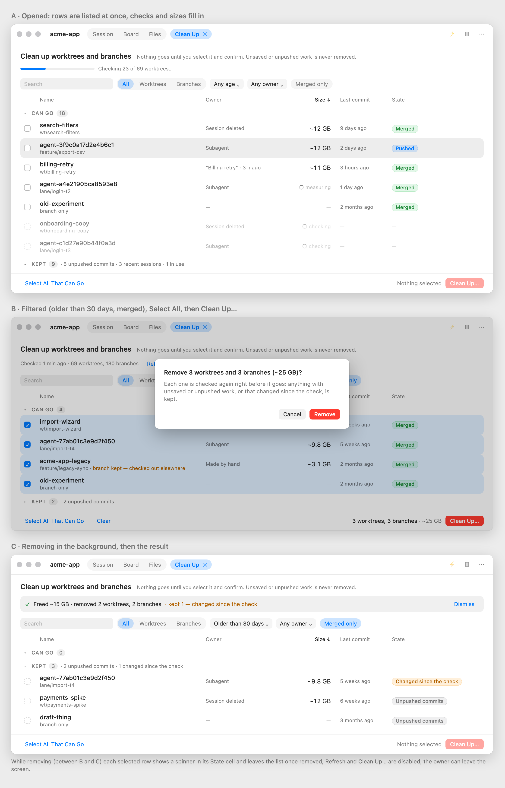

# Clean Up — one screen for worktrees and branches instead of sheets (board #1107) — design

**Status:** approved by the owner 2026-10-26 (ask #633; review rounds asks #629, #630, #631)
**Builds on:** `docs/superpowers/specs/2026-10-12-session-cleanup-design.md` (board #535) §8, §9, §12; PROJ-18 in
`docs/inventory/workbench.md`.
**Mockup:** `docs/design/mockups/worktree-cleanup/screen.html` (open with `#dark` for the dark appearance), rendered
as `screen-light.png` / `screen-dark.png` beside it — seven states: A opened and filling in, B filtered + selected +
the confirmation, C the result, D one session's scope, E the whole run failed (Retry), F another cleanup of the
workbench is running, G nothing to clean up. In the whole-workbench scope a row whose session is live or was active
within 7 days is never under **Can go** — the sweep keeps it `session_recent` (design §9); only a session's own scope
(D) offers such a session's worktrees.



## 1. Why

On the owner's own repository the **Clean Up Old Worktrees…** sheet (`WorkbenchSweepSheet`) cannot be used:

- **No bulk choice.** A measured sweep of the workbench repository (2026-10-26) lists 69 worktrees and 130 branches;
  53 worktrees (~294 GB) and 111 branches can go. The sheet offers one checkbox per row and nothing else — no select
  all, no filter, no sort.
- **Modal and slow.** The sheet shows nothing until the whole plan is ready: 18 s without sizes, 42 s with them on
  that repository (`internal/sessioncleanup`: per-worktree `git status`, the W9 nested walk, then a `du`-like walk of
  every removable worktree, 4 at a time, 20 s budget each). While it plans, the owner is locked out of the window.
- **Noise.** Kept rows are mixed into the list; every row says "Owner unknown" (5 of 199 items had a known owner,
  §4.3 says why), so the column tells nothing.
- **Two places.** The session row's **Clean Up…** sheet and the workbench's **Clean Up Old Worktrees…** sheet pick
  from overlapping data in two different UIs, and both can run an apply at the same time.

Done means: the owner opens the screen, sees the list within a second or two, sorts by size, selects everything
that can go (or everything merged and older than a month) in one or two clicks, confirms once, and keeps using the
app while it is removed.

## 2. Goals, non-goals, anti-goals

**Goals**
- One non-modal screen in the workbench window for choosing what to clean up — the whole workbench or one session;
  the owner can leave it and come back while it checks or removes.
- Rows appear as soon as git has listed them; checks and sizes fill in as they finish (§6 says how).
- Bulk selection: everything shown that can go, a ⇧-click range, ⌘A.
- Sort by size, age, name; filter by kind, age, owner and "merged"; search by name.
- A worktree and its branch are one row and go together.
- Kept items out of the way, grouped by why they are kept.
- Removal in the background with per-row progress and a one-line result.
- What ships looks like the mockup (§9).

**Non-goals**
- No change to any safety catch (PROJ-18, design §5). The screen only changes how the owner picks among items the
  CLI already marks `remove`; the apply still re-plans and re-checks every item.
- **Delete and Clean Up** in the delete dialog stays: it is part of deleting a session, not a place to pick (§3.2).
- No size cache on disk; no check the owner did not start (the one-time hint stays as it is).

**Anti-goals** — a failure even if it works:
- Anything removed the owner did not see selected. Selecting is the owner's act; the screen never pre-selects.
- A screen that again shows nothing until everything is checked.
- More settings or a wizard. One screen, one confirmation.
- A screen that looks different from its mockup.

## 3. Where it lives

### 3.1 The screen

The workbench page shows the Clean Up screen **in place of its workspace area** (the pane or split), like a page of
its own, while it is open. It is in-memory page state (`WorkbenchesViewModel`, per workbench: open or not and its
scope), not a `WorkspacePane` kind and not in `WorkspaceLayout`: nothing about it is saved, a relaunch never brings it
back, and closing it shows the workspace exactly as it was. The screen covers the workspace area rather than
replacing it in the view tree, so the terminal views behind it stay alive and are not re-created (the builder checks
this against `WorkspaceAreaView` in `WorkspacePaneView.swift` and proves it with a test).

- **Opening:** the ⋯ menu's **Clean Up Old Worktrees…** (whole workbench), the one-time hint's button (whole
  workbench), a session row's **Clean Up…** (that session, §3.2).
- **On screen:** the title row's `Session | Board | Files` control shows no segment on and a **Clean Up ✕** crumb
  beside it (mockup, title row). Clicking a segment or ✕ closes the screen and shows that view. The session strip is
  not shown (no session is on screen).
- **Leaving** the screen or switching workbench stops nothing: the plan lives in `SessionCleanupCenter`, the apply in
  `WorkbenchesViewModel.sweepRuns`; opening the screen again shows them as they are. Opening plans, unless a ready
  plan younger than `sweepPlanReuseWindow` (10 min) or a running one exists for that scope; the existing
  `cleanupHintTimeLimit` watchdog stays as a plan's stop.

### 3.2 One place to pick

The screen replaces **both** sheets: `WorkbenchSweepSheet` and the session row's `SessionCleanupSheet` are removed.

- **Scope.** The screen has a scope: the whole workbench (the CLI's `--sweep`, as today) or one session (the CLI's
  `--session N`, as the session sheet today — the session's own items with the session-mode ownership and orphan
  rules, unchanged). In session scope a chip **Session: “<title>” ✕** stands left of the filters; ✕ widens to the
  whole workbench (a new plan). Scope is not an owner filter: the two plans differ (session mode cleans a live
  session's own worktrees and may stop its orphans; the sweep keeps a live session's items `session_recent` and never
  signals a process), so each scope runs its own CLI mode.
- **Delete and Clean Up** stays in the session delete dialog (one button, the session's planned `remove` items, then
  the row is deleted — PROJ-17/18 as today). It does not pick, so it is not a second place to choose.
- **One apply at a time per workbench.** The view model already refuses a second sweep apply (`sweepRuns`); this
  widens to every cleanup apply of the workbench: while one runs (screen, or Delete and Clean Up), the screen's
  **Clean Up…** is disabled with "Another cleanup is running" and **Delete and Clean Up** is disabled with the same
  line (Delete Only stays). Every apply re-checks every item anyway (design §7); the rule is for a clear screen, not
  for safety.

## 4. Screen

See the mockup for the look; this section is what it does.

### 4.1 List

- **Built from the kit, not a stock `Table`.** Rows are `.kitRow(isSelected:)` rows in a `LazyVStack` under a
  column-header row of `.kitQuiet` sort buttons (the sorted column shows ↑/↓); no row dividers; groups under
  `SectionHeader` with a count. The checkbox is the system checkbox toggle; a row that cannot be chosen has none (an
  empty dashed box while it is being checked, nothing when kept). A stock `Table` is not used: it brings its own row
  separators and selection chrome, and its native selection cannot refuse single rows (round-1 review, ask #629).
- **Choosing.** Clicking a row or its checkbox ticks/unticks it; ⇧-click ticks or unticks the range from the last
  clicked row (rows that cannot be chosen in between are skipped); ⌘A = **Select All That Can Go**; Esc = **Clear**.
  The ticks are the choice. A row still being checked cannot be ticked until its check lands.
- **Columns:** checkbox · Name (worktree folder name, the branch in secondary text; a branch with no worktree shows
  its name and "branch only") · Owner (§4.3) · Size (`~12 GB` / `measuring` / `checking` / `size unknown` / `—` for a
  branch; `.monospacedDigit()`) · Last commit (relative, from the tip's committer date) · State (a `Chip`).
- **State chips** (`Chip`, colours from `Tone`, never a colour picked by hand): `Merged` (`Tone.success`) = the tip
  is in the default branch; `Pushed` (`Tone.status("blue")`) = only on a remote; a kept reason (`Tone.status("gray")`,
  the words from `SessionCleanupPresentation`); "Changed since the check" and other apply-time keeps
  (`Tone.warning`); an apply error (`Tone.error`).
- **Default sort:** Size descending, unmeasured rows last. Sort by Name, Size, Last commit by clicking the column
  title.
- **Groups:** **Can go (N)** first, unfolded; **Kept (N)** last, folded, its header listing the counts by reason
  ("5 unpushed commits · 3 recent sessions · 1 in use"); unfolded, kept rows show their reason chip and no checkbox.

### 4.2 Worktree + branch = one row

A worktree row carries its branch: ticking it removes the worktree and, when that branch's item is `remove`, the
branch too. When the branch is kept (checked out elsewhere, unpushed), the row's secondary line says so in
`Tone.warning` ("branch kept — checked out elsewhere", mockup B) and only the worktree goes. The worktree's `lsreg:`
items (LaunchServices entries of `.app` bundles inside it) are part of the row as well and go with it — otherwise
removing the folder would leave entries pointing at a deleted app. Branch-only rows are the branches with no
worktree; the sweep's stale-entry `lsreg` items (registered paths under the workbench folder that no longer exist) are
rows of their own named "LaunchServices entry". This needs the owner's approval (§8).

### 4.3 Owner

Why "Owner unknown" today: the ledger that says which session made a worktree (`terminal_session_worktrees`) is
deleted with its session row, and the owner deletes finished sessions — on the measured repository 6 sessions are
left and 4 of the 53 removable worktrees still match one. So the column shows what can be known, in this order:

1. **The session** — its title and last activity — when a session row still owns it (ledger, placement record or
   `folder_path`, as the sweep's `owner` does today).
2. Otherwise **where it came from**, from its path and branch alone: **Subagent** (a Claude Code subagent worktree,
   `.claude/worktrees/agent-<hex>`), **Session deleted** (a worktree Watchtower placed for a session,
   `.claude/worktrees/<name>` on a `wt/` branch, its session gone), **Made by hand** (any other linked worktree).
   Branch-only rows show `—`.

The **Owner** filter offers: Any owner · A session (1) · Subagent · Session deleted · Made by hand. The origin is
decided **in Go** and sent as a new item key `origin` (`session` / `subagent` / `placed` / `manual`; `""` for
branches and `lsreg` items) — the Desktop never repeats the rules (ask #630). The rules belong to the placement code:
the constants `worktreesDir` (`.claude/worktrees`) and `worktreeBranchRoot` (`wt/`) are unexported in
`internal/workbenchgit/worktree.go`, so `workbenchgit` gains one exported classifier — `WorktreeOrigin(topLevel,
root, branch string) Origin` (subagent = `<top>/.claude/worktrees/agent-<hex>`, placed = another directory under
`<top>/.claude/worktrees/` on a `wt/` branch, manual = anything else) — and `internal/sessioncleanup` calls it,
setting `session` itself when an owner session is known (ask #631). The import goes `sessioncleanup → workbenchgit`
(`workbenchgit` imports only `gitbin`, so no cycle). Pinned by `workbenchgit` tests next to the constants.

### 4.4 Filters and bulk selection

Toolbar, nothing saved: search by name · kind (`KitSegmentedPicker`: All / Worktrees / Branches) · age (a menu:
Any age / Older than 7 / 30 / 90 days, by last commit) · owner (a menu, §4.3) · **Merged only** (a toggle chip).
**Select All That Can Go** ticks every row that can be chosen among those the filters show — "Older than 30 days" +
"Merged only" + one click is the common case (mockup B). Ticks outside the current filters stay ticked and count in
the footer total.

### 4.5 Progress, footer

- **Progress line** under the title while planning: a thin bar plus "Listing worktrees…", "Checking N of M
  worktrees…", "Measuring sizes N of M…"; when ready "Checked 1 min ago · 69 worktrees, 130 branches" with
  **Refresh** (`.kitQuiet`).
- **Footer:** **Select All That Can Go** and **Clear** (`.kitQuiet`) on the left; the total of the ticks
  ("3 worktrees, 3 branches · ~25 GB", "some sizes unknown" when so, "Nothing selected") and **Clean Up…**
  (`.kitDestructive`, the screen's one prominent action, disabled with nothing ticked) on the right.

## 5. Confirming and removing

- **Clean Up…** asks once, in a sheet (a confirmation is the sheet's job per the style guide): "Remove 3 worktrees
  and 3 branches (~25 GB)?" / "Each one is checked again right before it goes: anything with unsaved or unpushed
  work, or that changed since the check, is kept." **Cancel** (`.kitSecondary`) · **Remove** (`.kitDestructive`).
- The apply runs in the background (`sweepRuns`, and the session scope's run, as today). Each ticked row shows a
  spinner in its State cell when its turn comes, then leaves the list once removed; a row kept at apply time (the
  re-check, git refused) moves to **Kept** with its new reason (`Tone.warning`). Rows not ticked are untouched.
- When it ends, a result bar replaces the progress line (mockup C): "✓ Freed ~15 GB · removed 2 worktrees, 2 branches
  · kept 1 — changed since the check" (from the CLI's `summary` / `removed_bytes`), **Dismiss**. A failure of the
  whole run shows in the same bar in `Tone.error` with **Retry** and **Dismiss** (mockup E): after a failed apply,
  Retry starts a new apply of the rows still ticked (the apply re-plans first, as every apply does — design §4); after
  a failed plan, Retry plans again and the rows already listed stay until the new run's `listed` replaces them
  (ask #631).
- While an apply runs, **Refresh** and **Clean Up…** are disabled; ticking other rows stays possible.

## 6. Showing rows before the plan is done — why the CLI streams

**How we got here.** The Desktop never runs git itself (design §12); it runs `watchtower workbench cleanup … --json`
and today gets one JSON object when the process exits — after every check and every size, 18–42 s later. The goal
"rows first, checks and sizes as they finish" (ask #628, point 2) therefore needs the CLI to say something before it
exits. Two ways were weighed:

- **Two calls** — a fast listing call (`--list-only`, under a second) and then today's full plan. Rows appear at
  once, but every row stays "checking" until the second call ends; nothing fills in progressively, and two processes
  read git twice.
- **One streamed call** (chosen) — the same command with `--stream` writes one JSON line per event as it goes: the
  listing first, then each item when its checks finish, then each size, then the full plan. Rows appear at once and
  fill in one by one; one process; the existing JSON stays the last line for anyone who wants only that.

The sweep and session commands stay as they are; new flag **`--stream`** (only with `--json`). Without it the output
is unchanged (agents, tests).

```
{"event":"listed","items":[ …items as in design §4.1, without "action" … ]}   // after git worktree list + for-each-ref
{"event":"checked","item":{ …the item with its action/reason… }}              // one per item, as its catches finish
{"event":"sized","key":"worktree:/…","bytes":11811160064,"bytes_known":true}  // one per measured worktree
{"event":"removing","key":"…"}  {"event":"removed","item":{…done:true…}}     // --apply only, in removal order
{"event":"done","plan":{ …the full design §4.1 object, unchanged… }}          // always last on success
```

- `listed` comes from the cheap git listing only (worktree list, branch list, default branch). A failure before
  `listed` is the old exit-1 path; a stream that ends without `done` is a failed plan for the Desktop (rows stay, with
  the error in the progress line).
- A worktree's bundle items (`lsreg:` found under it) carry `"worktree":"<root>"` and are emitted with that
  worktree's `checked` event, before sizing (the bundle scan moves ahead of `measureAll`), so a worktree row is
  complete — and can be ticked — once checked. Stale-entry `lsreg` items carry no `worktree`.
- Items gain three keys, streamed or not (additive, pinned in the JSON key test): `origin` (§4.3), `last_commit_at` (RFC 3339 UTC of the
  tip's committer date; `""` when unknown) and `merged` (bool: the tip is an ancestor of the local default branch or
  of `refs/remotes/origin/<default>` when it exists, so a branch merged on GitHub while the local `main` lags still
  reads as merged; false when unknown). Both come from one `git for-each-ref` over `refs/heads` plus one per detached
  worktree HEAD.
- Checks may finish in any order; within one run the Desktop applies events by `key`. `done.plan` is the authority:
  the Desktop replaces its rows with it.
- **Events never cross runs** (round-2 review, ask #630). Each plan or apply is one CLI process with its own stdout
  pipe; `SessionCleanupCenter` gives each run a fresh run id (a counter per scope) and keeps only the current one.
  **Refresh**, a scope change or closing on a failure first stops the old process (SIGTERM, as the hint watchdog does
  today) and drops its id; every line read from a pipe is applied only while its run id is still the scope's current
  one, so a late line of the old process is thrown away, never merged into the new plan's rows. An apply is never
  stopped this way: while one runs, Refresh and scope changes are disabled (§5). Pinned by a center test that feeds
  an old run's `checked` line after a Refresh.
- Apply events only report per item as the apply goes; its logic, order and re-checks (design §7) are unchanged.
- **Speed.** The work inside the plan keeps its order, except that the listing is emitted first and each item's
  `checked` event as soon as its catches are done; sizes still run after the checks, only for `remove` worktrees.
  Where the 18 s goes (git status vs the W9 walk vs lsof) is measured in plan Task 0; a cheap speed-up found there
  (e.g. the per-worktree checks in parallel, as sizes already are) is in scope, a deeper one is not.

## 7. Desktop internals

- `SessionCleanupCenter` runs both scopes streamed: per scope it keeps the current run id (§6), the rows received so
  far, the stage (listing / checking N of M / sizing N of M / ready / failed) and the plan's time. It still never
  runs git itself.
- The row model (pairing, origin, filters, sort, "can be chosen", ⇧-range, the totals, the confirmation and result
  texts) is pure WatchtowerCore code (e.g. `CleanupScreenModel`), tested in `Tests/Core`.
- The apply passes exactly the keys of the ticked rows — for a worktree row its own key, its branch's key when that
  branch item is `remove`, and its bundles' `lsreg:` keys — of known kinds only (the existing
  `removableItems(among:)` rule).
- The view coalesces `checked`/`sized` events (no more than a few redraws per second).
- The `Session | Board | Files` control gains a "none on" state while the screen is open.

## 8. Contracts

No safety contract is weakened. PROJ-18's "the sweep ticks nothing by itself" holds (ticks are the owner's click, ⌘A
or Select All). PROJ-17's Delete and Clean Up is unchanged apart from being disabled while another cleanup of the
workbench runs.

**Approved by the owner (ask #633) — a guard test changes.** The worktree + branch pairing (§4.2) is new behaviour, and the
PROJ-18 guard `testSweepAppliesOnlyTickedKeys` (`WatchtowerDesktop/Tests/SessionCleanupSweepTests.swift`) asserts
the opposite: ticking a worktree whose branch is also removable sends only the worktree's key. With approval,
PROJ-18 gets an amendment ("on the Clean Up screen a worktree row is the worktree, its branch when that branch item
is `remove`, and its bundles' entries; the apply sends exactly the ticked rows' keys so expanded, of known kinds
only") and the test is rewritten for it — keeping its assertions on unknown kinds, kept items and stray keys, adding
one for the pairing. Without approval, the branch is a second checkbox inside the row, unticked. The other sweep and
session-sheet guards (`testSweepTicksNothingByDefault`, `testSweepNeverAppliesUnknownKinds`,
`testSweepSurvivesLeavingThePage`, `testSheetApplyMarksTheRowBusy`, …) move to the screen with their assertions
unchanged. The session sheet's "`remove` items ticked" (design §12) becomes "nothing ticked" in session scope too —
one rule for the one screen (stricter, not weaker).

The `--json` output gains three keys (additive); `--stream` is new.

## 9. Looks like the mockup — checked twice

- **Before code:** the mockup in `docs/design/mockups/worktree-cleanup/` is the agreed look (this review).
- **After code, before merge:** the screen is registered in `DesignShotCatalog` on fixture data (`acme`,
  `example.com`) in the mockup's seven states (A–G);
  `make desktop-shots` renders light and dark; the implementer puts each shot beside the matching mockup PNG, lists
  every difference and fixes it or names why not; the shots and that list go to the owner as a check ask before
  merge (style guide "See your screen", step 4).

## 10. Guide

`docs/guide/features/workbench/worktrees-and-cleanup.md` is updated for the screen (where it opens, select all,
filters, the session scope), following `docs/guide/WRITING.md`. Feature pages have an 8 KB cap without their learn
cards (`TestFeaturePagesUnder8KB` in `docs/guide/guide_test.go`); the page is 5.5 KB today, so the screen's text
replaces the two sheets' paragraphs and adds at most ~2 KB. If it does not fit, the screen gets its own page
(`features/workbench/cleanup-screen.md`) linked from this one. `go test ./docs/guide` runs with the change
(ask #631).

## 11. Left to the builder

- Column widths; the empty state (mockup G) is built from `TabEmptyState` / `FeatureEmptyState`.
- Whether rows that leave after removal fade or vanish (`Motion.panel` if they fade).
- Event decoding details.

## Decisions

- Make it a screen, not a popup; it must not block the owner while it plans — conversation (owner, 2026-10-26).
- The points proposed in the conversation (non-modal screen; list first, sizes later; bulk selection; sortable
  table; kept items folded; background removal with progress) are accepted as they are — ask #628.
- Nothing is pre-selected; one "Select All That Can Go" click is the bulk path — conversation proposal, accepted in
  ask #628.
- Owner column and an owner filter are needed — ask #629. What can be known is shown: the session, else the
  worktree's origin (Subagent / Session deleted / Made by hand) — my call, §4.3; the origin is computed in Go, not
  repeated in Swift — ask #630.
- Every state has a mockup: session scope, run failure with Retry, another cleanup running, empty — ask #630.
- Stream events are bound to their run; a late line of a stopped run is dropped — ask #630 (§6).
- In the whole-workbench scope a live or recent session's items are never under Can go (mockup A fixed) — ask #630.
- The origin classifier is exported from `internal/workbenchgit` (where the placement constants are) and called by
  `internal/sessioncleanup` — ask #631.
- Retry as in mockup E: a new apply of the ticked rows, or a new plan after a failed plan — ask #631.
- The guide page stays under the 8 KB cap, else the screen gets its own page — ask #631.
- A mockup is a must, and the shipped screen is compared against it before merge — ask #629 (§9).
- Kit components and `Tone` colours, no stock `Table`; stock `Table` selection cannot refuse rows — ask #629.
- In memory only: the screen is page state, not a saved pane; a relaunch does not bring it back — ask #629.
- One place to pick: the screen replaces both the sweep sheet and the session's Clean Up… sheet; Delete and Clean Up
  stays in the delete dialog; one cleanup apply per workbench at a time — ask #629 (owner asked for one place; this
  shape is my proposal, §3.2).
- `--stream` (one streamed call) over two calls — my call, explained in §6 at the owner's request (ask #629).
- `merged` counts `origin/<default>` as well as the local default branch — my call (§6).
- Plan speed-ups only where cheap, after measuring in plan Task 0 — my call (§6).
- Worktree + branch + its LaunchServices entries in one row, with the PROJ-18 guard test rewritten and PROJ-18
  amended — approved with the spec, ask #633 (§8).
