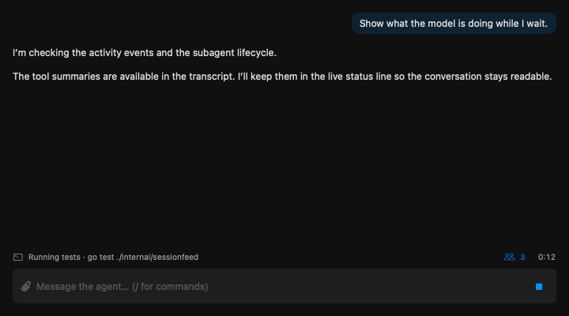
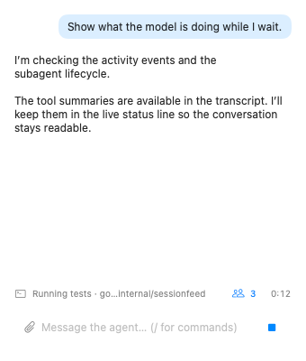
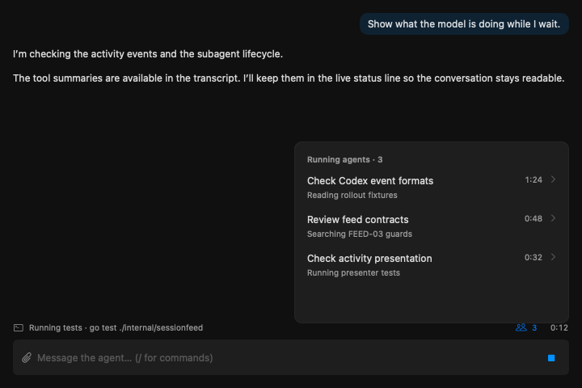

# Workchat: одна живая строка и доступ к агентам

Таргет #1481. Переработано после коррекции владельца 2026-11-02. Спецификация одобрена владельцем в ask #933; правила snapshot и stale — в ask #932.

## Задача

Пока модель работает, видеть её реальные текущие/последние действия и знать, сколько агентов запущено. Всё это помещается в существующую caption-строку над composer. Геометрия диалога и поля ввода сохраняется.

В текущем коде Claude/Codex используют общий fallback `Thinking…`. Источник наблюдаемого владельцем `Waiting model` пока не подтверждён. `ActivityOf` возвращает только открытый инструмент: короткие вызовы целиком проходят между опросами (3 с) и пропадают после результата. Codex activity уже поддерживает function/custom calls, но его parser не строит маркеры субагентов.

## Вид и взаимодействие

Ровно одна caption-строка, без нового фона, карточки, заголовка или разделителей. Слева мелкая иконка и текущее **или** последнее действие. Справа компактная кнопка `person.2 3` и время. Существующие отступы и высота `WorkchatActivityLine` сохраняются; строка остаётся пустой в idle. Длинный текст обрезается в середине; полное действие доступно по наведению. Retry и счётчик агентов не обрезаются даже при ширине 340 pt.

Примеры: `Running tests · go test ./internal/sessionfeed`; после завершения инструмента — `Last · Read SessionFeed.swift`; если действий ещё нет — `Working…`. Текущее и последнее не показываются двумя строками одновременно. Никакой ротации придуманных статусов, процентов или дополнительной генерации текста моделью.

Агенты видны только как маленькая кнопка со счётчиком. Нажатие открывает привязанный к кнопке popover: заголовок `Running agents · 3`, далее плоский список переходов (задача, последняя подтверждённая активность, время). Без карточек и разделителей между строками. При большом числе агентов прокручивается только список popover, диалог не сдвигается. Клик по строке открывает существующий read-only диалог выбранного агента; Esc/клик снаружи закрывает popover. По умолчанию он всегда закрыт и сам не открывается при запуске новых агентов. При смене сессии закрывается.

Если число достоверно равно нулю, кнопка скрыта; если источник недоступен, `person.2 ?` с подсказкой `Agent status unavailable`. Unknown не подменяется нулём. Стабильный id сохраняет идентичность при запуске/resume/закрытии. Фоновый агент не становится завершённым только потому, что вернулся результат launch tool. Завершённый агент уходит из списка активных, существующий маркер в истории остаётся.

## Семантика данных

- `current` — реально открытый вызов с id и временем начала; результат закрывает его. Параллельные вызовы — наиболее новый плюс существующее `N more`, без нового раскрытия.
- `latest` — последнее завершённое действие **текущего хода**, отдельное от `current`, читается независимо от cursor. Между вызовами строка показывает `Last · …`; пустой latest означает `Working…`.
- Таймер current — длительность инструмента; при `Last` справа идёт длительность текущего хода, завершённый инструмент больше не «работает». Таймер агента — от начала текущего интервала запуска/resume. Неизвестное время не показывается.
- Новый ход/conversation, Stop, завершение или idle очищают строку и активный список. Предыдущее действие не переносится в новый ход. История остаётся прежней.
- Успешная выборка содержит `observed_at`. Через 10 с без успешного обновления при видимом окне — одна строка `Activity out of date · Ns ago`, Retry, счётчик `?`; таймеры/анимации заморожены. Ошибка чтения сразу показывает `Activity unavailable` и Retry. Старый снимок не изображается текущей работой.
- Возврат на экран вызывает немедленное чтение. Существующие off-screen gates, последовательный опрос раз в 3 с и ограничение одного CLI сохраняются; отдельного процесса на карточку/агента нет.
- Permission card сохраняет существующий приоритет: скрыта вся живая строка. Отдельных управляющих действий для агентов не добавляется.
- Движение только у подтверждённого current, не у Last; Reduce Motion отключает анимацию. VoiceOver не озвучивает каждую секунду таймера. Все тексты из presentation-модели и покрыты тестами.

Claude нормализует tool_use/result и метаданные субагентов. Codex требует нормализации launch/result/resume/close по идентификаторам поддерживаемых rollout-событий; неподдерживаемые/неполные данные дают unknown. Нужны синтетические fixtures жизненного цикла обоих провайдеров. Переход к агенту доступен только при подтверждённом разрешённом пути, без открытия произвольного файла по внешнему id.

## Состояния и макеты

Каждый PNG содержит существующую структуру диалога и composer; меняется только строка. Открытый popover снят отдельно и не является основным состоянием интерфейса.

| Состояние | Строка | Макет |
|---|---|---|
| Основная работа | действие слева, `person.2 3` и время справа | `workchat-activity-busy` |
| Узкий скоуп 340 pt | та же строка, обрезка действия в середине | `workchat-activity-narrow` |
| Агенты открыты по клику | компактный popover плоских строк | `workchat-activity-agents-open` |
| Много агентов | прокрутка внутри popover, без изменения чата | `workchat-activity-overflow` |
| Пусто / idle | пустая строка прежней высоты, обычный composer Send | `workchat-activity-empty` |
| Загрузка | `Loading activity…`, без выдуманного ответа | `workchat-activity-loading` |
| Между действиями | `Last · Read SessionFeed.swift` | `workchat-activity-thinking` |
| Ошибка | `Activity unavailable`, `Retry`, `person.2 ?` | `workchat-activity-error` |
| Stale | `Activity out of date · 18s ago`, `Retry`, `person.2 ?` | `workchat-activity-stale` |
| Агенты unknown | `Working…`, `person.2 ?` | `workchat-activity-agents-unknown` |

Макеты: `docs/design/mockups/workchat-live-activity/index.html`, light/dark для всех десяти состояний. Источник: `WatchtowerDesktop/Tests/DesignShots/DesignShotFixtures+WorkchatActivity.swift`, регистрация в DesignShotCatalog. Цвета статусов только Tone; сама строка secondary, без собственной заливки. Fixture не подключён к приложению.

## Контракты и проверка реализации

FEED-01/02/04/05 сохраняются: транскрипты только читаются; действия не становятся entries, не копируются в БД и не публикуются на телефон. FEED-03 `activity` сохраняет старые ключи и значение «открытый вызов». Новые данные — отдельный опциональный `live` snapshot (`observed_at`, `current`, `latest`, `agents`, `agents_state`) и `live_ok`/`live_error`. Старый CLI читается с unavailable, без ошибки декодирования. Пустые массивы — `[]`. Snapshot ограничен по объёму, обрезка списка обозначена счётчиком; публичные id не дают произвольный доступ к файлам.

Изменения PROJ-* не предлагаются: permissions, Stop, доставка строк и состояние сессии сохраняются. Новый snapshot и warning/Retry при stale10 одобрены владельцем в ask #932. Предыдущие asks #928/#929 отозваны после отклонения массивного дизайна и не являются одобрением этой версии.

Проверки: guard tests FEED/PROJ; open→complete→Last; короткое действие между polls; новый ход/Stop; Codex/Claude запуск/resume/закрытие; stale/error/Retry; unknown≠zero; legacy decode; zero timestamps; off-screen polling; регрессия SessionFeedStore, где старый activity остаётся после ошибки; тексты из модели; popover closed/open/overflow; узкая ширина. После реализации повторить те же shots и сравнить с макетами.

## Decisions

- Единые статусы Claude/Codex, реальные последние действия вне истории, видимость запущенных агентов — владелец, conversation 2026-11-02.
- Только строка; ненавязчивое отображение агентов; не перестраивать чат — владелец, correction conversation 2026-11-02. Предыдущая большая панель отклонена.
- Иконка и действие слева, счётчик агентов и время справа; popover только по клику, плоские строки без карточек — владелец, ask #933 (одобрение спецификации).
- Current или Last в одной строке, Working fallback, unknown≠zero — владелец, ask #933.
- Предупреждение и Retry в строке при ошибке или stale10 с остановкой таймера — владелец, ask #932.
- Существующий `activity` сохраняется, optional live snapshot, Desktop only — владелец, asks #932 и #933; расширение аддитивное, исходные FEED/PROJ guard contracts сохраняются.
