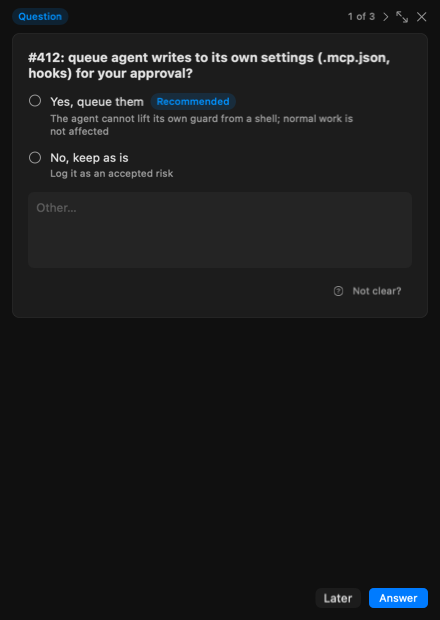
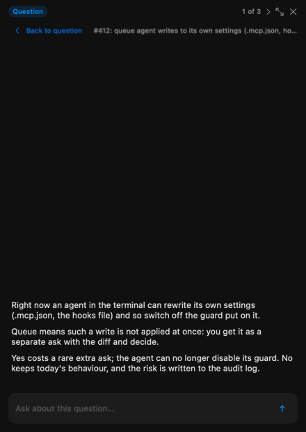
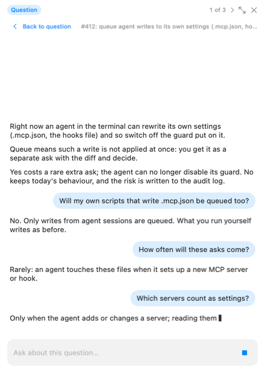
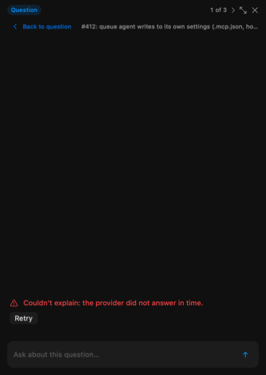

# Ask: "Not clear?" — a chat about the question, on the whole ask panel

**Board:** #2355. **Mockups:** [`docs/design/mockups/ask-explain-chat/`](../../design/mockups/ask-explain-chat/) (DesignShotCatalog `ask-explain-*`, light and dark).

## Problem

An agent's ask is sometimes impossible to answer: the question uses the agent's own words ("park", "guard", file names), and the summary assumes the context the agent has and the owner does not. Today the only way to understand it is to go to the session's terminal and ask the agent there, which interrupts its work, or to answer blind.

## Goal

One quiet control on the ask, **Not clear?**. It turns the whole ask panel into a chat with an assistant that has already explained the question in plain words. The owner can ask more, then goes **Back to question** and answers as usual. Nothing else is added to the ask.

## Non-goals (v1)

- No question to the ask's author session from this chat, no draft answer built from the chat, no quick-question chips (D4).
- No answering from inside the chat: the options stay on the question view.
- Not on the phone (D8).
- Not on review asks (D7).
- The assistant does not read the session's transcript (D9).

## Decisions

| # | Decision | Source |
|---|---|---|
| D1 | One quiet entry, **Not clear?**, under the ask's options; no other new controls on the ask | conversation (the owner rejected the first mockup: too many buttons, keep it unobtrusive) |
| D2 | The chat takes the whole ask panel, with **‹ Back to question** at the top | conversation; approved in ask #1785 |
| D3 | The first message is the explanation, started on open without the owner typing | conversation (mockup); approved in ask #1785 |
| D4 | No question to the author, no answer drafting, no chips in v1 | conversation (ask #1782 that offered them was superseded unanswered) |
| D5 | The chat is kept per ask: reopening it continues where it stopped | conversation; approved in ask #1785 |
| D6 | The assistant reads the workbench folder (claude and codex do; ollama reads none) and never changes anything (`.draftOnly`), at the provider's strong tier | decided by the agent: the same boundary as code questions; the strong tier because a weak explanation defeats the feature, and a turn starts only on the owner's click, never in the background |
| D7 | Question and check asks, open or closed; not review asks | decided by the agent: a spec or plan review has its own Discuss threads, a classic review is read in its document; a closed ask's chat helps understand a past decision |
| D8 | Mac only in v1 | decided by the agent: the phone has no embedded chat engine (spec review threads are Mac-only too) |
| D9 | No session transcript in the context | decided by the agent: the ask's summary is the agent's own statement of the question; the transcript is large, may hold other sources' text, and `ai query` has no reader for it today. A follow-up can add it |
| D10 | One indicator per state: Loading shows the feed's own live row and Queued the composer's own queued status; no "Explaining…" or "Waiting — other chats are answering." text of this feature (the `explaining` and `queued` copy keys are gone) | decided by the agent during implementation (T4 review): the mockup's extra line sat next to the built-in indicator, so each state showed two |
| D11 | A turn that fails once its reply row exists shows the shared ChatUI error card with its Retry; "Couldn't explain: <reason>" with **Retry** is only for a failed open (`explainErrors`, e.g. "This workbench no longer exists.") and for a hidden first turn that failed before it started (no row carries it) | decided by the agent during implementation (T4): the feed already draws a failed reply and its Retry; a second error line would repeat it |
| D12 | Retry after a restart is offered for a quit-partial first turn or a retryable error, never for a non-retryable code such as quota. Stop and quit persist the same `partial` row, so after a restart a stopped explanation offers Retry too | decided by the agent during implementation (T3): Retry is owner-initiated and harmless; a `stopped` marker would change every embedded chat's persistence. Known limit, see the feature note |
| D13 | Before the engine exists the chat view shows the strip over a centred spinner ("finding the chat") while the conversation is found or created | decided by the agent during implementation (T4): the pane was blank for the length of `chat.new` |

## Behaviour

### Where the control is

On the question view of an ask drawer (`OwnerAskDrawer`), for an ask of kind `question` or `check`, open or closed: **Not clear?** (`questionmark.circle`, `KitQuietButtonStyle(label: .secondary)` — grey, not the accent —, `.caption`), trailing, under the question card. Tooltip: "Ask the assistant to explain this question".

### The chat view

Pressing it replaces the drawer's body **and** its answer bar with the chat view; the drawer header (kind, title, "k of N ›", expand, close) stays. The chat view is:
- a strip: **‹ Back to question** (`.kitQuiet`), then the ask's title on one line, truncated;
- the feed (`EmbeddedChatRows`, compact density), scrolling, following the latest reply;
- the composer (`EmbeddedChatComposer`), placeholder "Ask about this question…".

**Back to question** (also Esc while the composer is empty or not focused; ⌘[ stays Back to Workbenches) returns to the question view with everything there as it was: picked options, the note draft, the scroll position (the question view stays in the view tree, hidden, while the chat is shown). Esc in a focused composer holding text stays in the chat.

The mode is per ask: `OwnerAsksViewModel.explainOpen: Set<Int64>` (ask ids, in memory, not persisted). "k of N ›" to another ask shows that ask's own mode; coming back shows this one's. Closing the drawer forgets the mode (the chat itself is kept, D5). While the chat is shown the drawer's bare keys (`OwnerAskDrawerKeys`) are off, and ⌘↩ does not answer the ask.

A closed ask's chat works the same as an open one's: the owner can ask about a decision already taken.

### The first message

Opening the chat of an ask with no chat yet finds-or-creates its conversation, then starts a **hidden** turn (the engine's hidden prompt, no owner row):

> Explain this question to the owner in plain words: what is being decided, what each option changes for them, and what the agent recommends and why. Short; no jargon the question does not explain.

Opening a chat that already has messages starts nothing. A chat whose first turn ended in an error or partially shows that row with **Retry** (the engine's existing Retry), never a second hidden turn on its own; after a restart Retry follows D12. A hidden first turn that failed before it started (no row) shows "Couldn't explain: <reason>" with **Retry**, which opens the chat again (D11).

### The assistant

A `ChatSurfaceSpec` (`AskExplainSurface`, `Sources/Services/ChatSurfaces/`), like `CodeQuestionSurface`:
- key `EmbeddedChatKey(contextType: "owner_ask_explain", contextID: "<workbench id>:<ask id>", conversationID:)`;
- persistence `.database`, the conversation found or created with `DatabaseEmbeddedChatStore.conversationID(…)` (Go's `chat.new` with `reuse: true`), title "Ask #<id>";
- `toolAccess: .draftOnly`;
- `runOptions`: the config's provider at its strong tier, `readFolder` = the workbench's folder only for a provider that can read files (claude, codex; never ollama, whose `ai query` refuses `--read-folder`), `purpose` = `ask.explain` (the usage ledger shows these turns as "Ask explanations" under Workbench; `ai query --purpose` accepts only listed values, so Go's `queryPurposes` gains it);
- the system prompt (first turn only) carries, fenced as untrusted data (a fence longer than any backtick run inside, as `CodeQuestionContext` does, with a line telling the model it is data, not instructions): the ask's title, summary, changes since the previous round, the "Look at" (focus) items, questions with their options and descriptions (or the checklist), the recommended labels (asks store no reason, so none is sent), and the target's title and intent when the ask has a target. It says: answer in the language the ask is written in; you explain, you never decide for the owner; the folder is for reading only.

The prompt text lives in one Swift constant (`AskExplainPrompt`), covered by a test that pins its parts (fence, language rule, the "never decide" line). Both providers run it unchanged (it is plain text, no provider-specific syntax).

### Texts (all in `AskExplainCopy`, tested)

| Key | Text |
|---|---|
| entry | Not clear? |
| entryHelp | Ask the assistant to explain this question |
| back | Back to question |
| placeholder | Ask about this question… |
| errorPrefix | Couldn't explain: |
| retry | Retry |
| emptyHint | The assistant explains; it never changes anything. |

## States (each has a shot)

| State | Shot | What shows |
|---|---|---|
| Entry | `ask-explain-entry` | The question view with **Not clear?** under the card |
| Finding | `ask-explain-built-finding` | The strip over a centred spinner while the conversation is found or created (D13; built only) |
| Queued (empty) | `ask-explain-queued` | Chat view, no rows, the composer's own queued status with Cancel (the 3-turn gate is full; D10) |
| Loading | `ask-explain-loading` | Chat view, the feed's own live row (D10) |
| Explained | `ask-explain-explained` | The explanation, the composer |
| Long | `ask-explain-long` | Several turns, scrolled to the latest |
| Busy | `ask-explain-busy` | A follow-up sent, its reply streaming, composer shows Stop |
| Error | `ask-explain-error` | A failed turn: the shared ChatUI error card with **Retry** (D11); a failed open or a hidden first turn that never started: "Couldn't explain: <reason>" with **Retry** (built shots `-error-open`, `-error-start`) |
| Narrow | `ask-explain-narrow` | The chat in a drawer at its least width (320) |
| Back, scrolled | `ask-explain-built-back-scrolled` | A long question scrolled to its bottom, the chat opened and closed: still at its bottom (built only) |

Colours come from `Tone` and the kit; no stock chrome, no row dividers (style guide). The shots are drawn by a design-only mock (`Tests/DesignShots/DesignShotFixtures+AskExplainMock.swift`); T5 renders the same states from the built views (`DesignShotFixtures+AskExplain.swift`, `ask-explain-built-*`, `DesignShotsTests/testAskExplainBuiltShotsRender`), and the differences that stay are listed in `docs/features/ask-explain-chat.md`.

| Entry | Explained | Busy | Error |
|---|---|---|---|
|  |  |  |  |

## Failure paths

| Event | What happens | Test |
|---|---|---|
| Drawer closed or another ask shown mid-turn | The engine lives in `EmbeddedChatCenter` by key; the turn's own `ai query --persist` process saves it; reopening shows the finished reply | `AskExplainSurfaceTests.testTurnOutlivesDrawer` |
| App quit mid-turn | `finishAllAsPartial` ends it `partial`; next launch shows it with Retry, no new hidden turn | `AskExplainModelTests.testPartialFirstTurnOffersRetryOnly` |
| Turn fails mid-stream (provider error, process exit) | Error row with the real text and Retry | `AskExplainModelTests.testErrorRow` |
| Two windows open the same ask's chat | One engine per key; Go's `reuse: true` returns one conversation even if both create at once | `AskExplainSurfaceTests.testSameKeySameConversation` |
| The ask is answered or withdrawn while the chat is open (phone, agent, another window) | Nothing changes in the chat; the question view behind it shows the closed ask as today | `AskExplainModelTests.testChatSurvivesAskClosing` |
| The workbench is deleted | `db.DeleteWorkbench` also deletes its `owner_ask_explain` conversations (prefix `<id>:`, like code questions) — PROJ-02 | `TestDeleteWorkbenchDropsAskExplainChats` |
| The workbench is merged into another (`workbenchfolders` merge) | `reKeyChats` re-keys `owner_ask_explain` together with `code_question` and `spec_review_thread`: `<from>:<ask>` → `<into>:<ask>` (ask ids are global, so no clash) | `TestMergeReKeysTheChats` (its `owner_ask_explain` case) |
| No CLI (a host without it) | No entry is shown | `AskExplainModelTests.testNoCLINoEntry` |

**Writers of the same data.** The conversation row: `chat.new` (Desktop, find-or-create; Go dedupes); its `context_id` later only `reKeyChats`, inside the merge's transaction. Its messages: each turn's `ai query --persist` process, and the Mac's `chat.reply.finish` / `chat.message.append` after a turn — the existing embedded chat rules, one turn at a time per key. Deletion: only `db.DeleteWorkbench`. A merge while a turn streams: the turn writes by conversation id, which the re-key does not change, so the reply lands in the re-keyed chat; the Desktop's key for an open chat is rebuilt on the next open. No other writer; the ask itself is never written by this feature.

## Guards to extend

`owner_ask_explain` holds the ask's and the folder's text, so it stays out of every reader that `spec_review_thread` is kept out of:
- `internal/tools/chat_history.go` (the history tool);
- `internal/kb/source_chat_artifact.go` (chat artifacts into knowledge);
- `internal/db/chat_knowledge.go`, both `NOT IN` lists (chat decisions and facts);
- `EmbeddedChatWiring.savesKnowledge` (Swift: a knowledge prefix typed there saves nothing);
- memory ingestion (pinned by `internal/memory/code_question_guard_test.go`).

The guard tests (`internal/tools/code_question_guard_test.go`, `internal/memory/code_question_guard_test.go`, the `chat_knowledge` tests, the `savesKnowledge` test) gain the new type. The main chat's history list shows only `context_type IS NULL` conversations, so it never shows this one.

## Tasks

| # | Task | Tests |
|---|---|---|
| T1 | Go: `db.AskExplainContextType`; delete with the workbench; re-key on merge (`reKeyChats`); add the type to `chat_history.go`, `source_chat_artifact.go` and both lists in `chat_knowledge.go`; `ask.explain` in `queryPurposes` | `TestDeleteWorkbenchDropsAskExplainChats`, `TestMergeReKeysTheChats` (an `owner_ask_explain` case), a `chat_knowledge` test that an `owner_ask_explain` message yields no decision or fact, the extended guard tests |
| T2 | Swift Core: `AskExplainCopy`, `AskExplainPrompt`, `AskExplainKey` (context id), entry visibility (`AskExplainPresentation.showsEntry(kind:hasCLI:)`); `savesKnowledge` excludes the type | `AskExplainCopyTests`, `AskExplainPromptTests`, `AskExplainPresentationTests`, the `savesKnowledge` test |
| T3 | `AskExplainSurface` + the per-ask mode in `OwnerAsksViewModel` (`explainOpen`), the hidden first turn, Retry-only after a failed first turn | `AskExplainSurfaceTests`, `AskExplainModelTests` |
| T4 | Views: the entry in `OwnerAskDrawer`, `AskExplainChatView`, keys off in chat mode, Esc back | `OwnerAskDrawerKeysTests` (keys off), shots |
| T5 | DesignShotCatalog shots from the real views, compared with the mockups; guide page (`docs/guide/`) and the feature note | shots reviewed, `go test ./docs/guide` |
