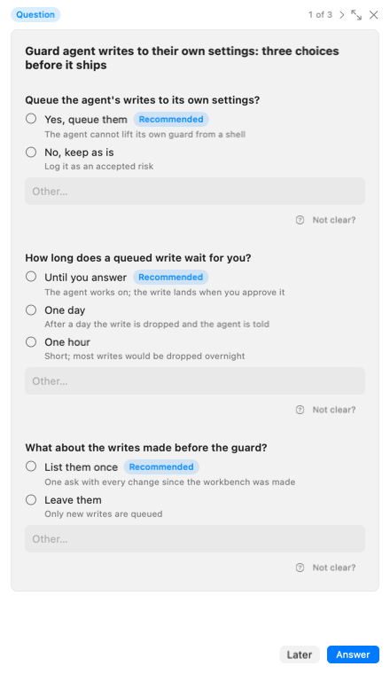
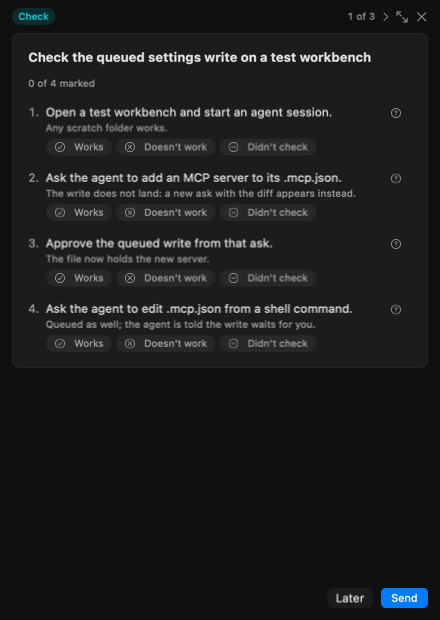
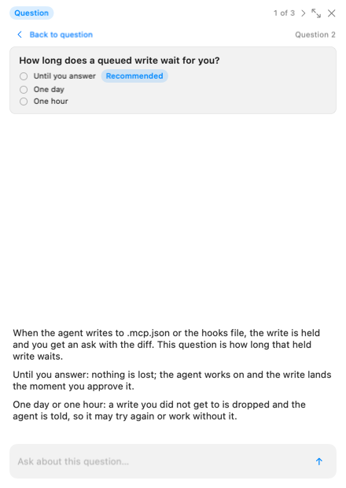
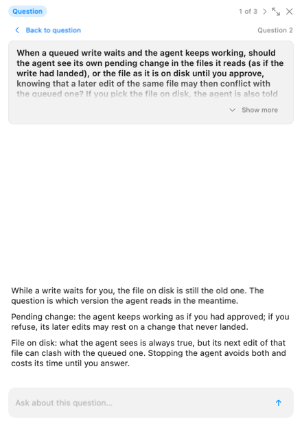
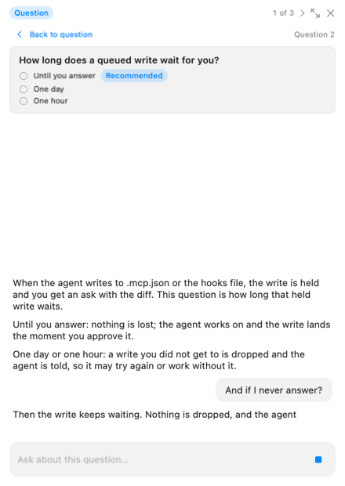
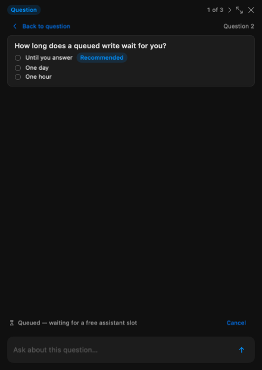
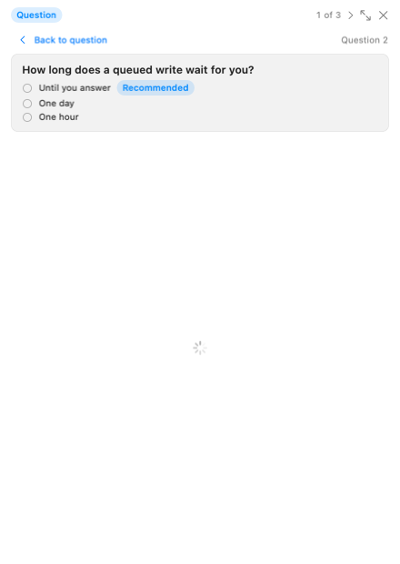
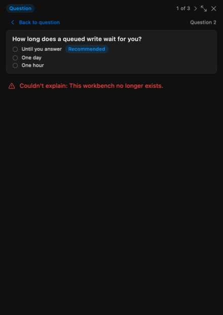
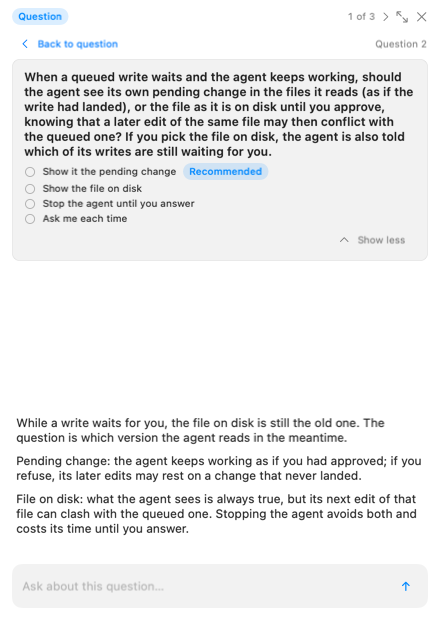
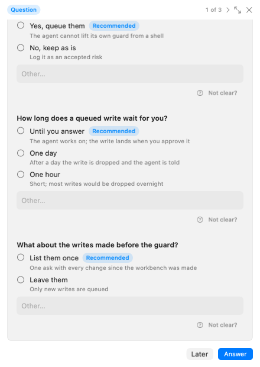

# Ask: "Not clear?" on each item of an ask, with the item pinned over the chat

**Board:** #2412 (follow-up to #2355 and its race fixes #2383). **Mockups:** [`docs/design/mockups/ask-explain-per-item/`](../../design/mockups/ask-explain-per-item/) (DesignShotCatalog `ask-explain-*` from `WatchtowerDesktop/Tests/DesignShots/DesignShotFixtures+AskExplainItemsMock.swift`, light and dark; the first eight shots approved in ask #1862, the six spec-review shots — busy, queued, finding, open-failed, card-expanded, back-scrolled — approved in ask #1870). **Builds on:** [`2026-11-24-ask-explain-chat-design.md`](2026-11-24-ask-explain-chat-design.md) (D1–D14) and the feature note [`docs/features/ask-explain-chat.md`](../../features/ask-explain-chat.md). Everything this spec does not change stays as written there.

## Problem

The owner's words: the **Not clear?** entry sits under the whole ask, but an ask often holds several questions or check steps and the owner wants it on each one. And once the chat opens, the question is gone from view: the owner needs a short, laid-out copy of the question (or of the item) on top of the chat to see what it is about.

## Goal

1. Each question of an ask and each step of a check gets its own quiet entry. The whole-ask entry goes.
2. Each item has its own conversation, explained on first open.
3. The chat shows a compact card of its item, pinned above the feed.

## Non-goals

- Still no question to the author session, no answer drafting, no chips (2026-11-24 D4); no answering from the chat.
- Still Mac only (2026-11-24 D8), still no review asks (D7), still no transcript (D9).
- No keyboard shortcut that opens the chat of the item under the drawer's keyboard cursor (D15).
- No migration of the whole-ask chats made by 0.29.5: a single-item ask uses its legacy chat as is (no row is rewritten); a multi-item ask's legacy chat is not shown (D4).

## Decisions

| # | Decision | Source |
|---|---|---|
| D1 | An entry on each item; no whole-ask entry. An ask with one item shows one entry. This replaces 2026-11-24 D1 | conversation (the owner's request: "Not clear" on the ask's items, not only under the whole ask); ask #1862 |
| D2 | A question's entry is today's **Not clear?** (`questionmark.circle`, `KitQuietButtonStyle(label: .secondary)`, `.caption`), trailing, at the foot of that question's block (under its Other… field). A step's entry is a small quiet **?** (the same icon, no text) at the trailing end of the step's text row; tooltip "Ask the assistant about this step". Every entry's accessibility label names its item: "Not clear? Question 2", "Not clear? Step 3" (`AskExplainCopy.entryAccessibilityLabel`); the visible text is unchanged | ask #1862 (mockups `items-entry`, `check-entry`); the accessibility labels: agent proposal (this spec), approved in ask #1870 (added in spec review round 1) |
| D3 | One conversation per item. Context id `<workbench>:<ask>:<item>`, `<item>` = `q<N>` (a question) or `s<N>` (a check step), N the item's 1-based index in payload order, written canonically (no sign, no leading zero). The index, not the agent's `id`: ids are free text (Go defaults them to the index, but an agent may write `"pick-db"` or `"a:b"`). The index is stable because the payload's questions and checklist are never rewritten after filing (a new round is a new ask; the only payload write after filing is the merge's `$.other_bench` on folder asks), pinned by a guard test (D18) | agent proposal (this spec), approved in ask #1870 |
| D4 | Go accepts the 3-part id under the same canonical rule as the 2-part one and still accepts the legacy 2-part `<workbench>:<ask>`. A whole-ask chat made by 0.29.5 on an ask with **one** item (one question and no steps, or one step and no questions) becomes that item's chat: the open looks the legacy conversation up first and uses it when it exists, else finds or creates the 3-part one, so an explanation already received is not lost. On an ask with several items the legacy chat gets no entry: it stays in the database, unseen, and still goes with its workbench and follows a merge (delete and re-key match the `<workbench>:` prefix, so they cover both shapes) | agent proposal, shown to the owner in ask #1868 |
| D5 | The chat shows a compact card of its item under the strip, pinned (it never scrolls with the feed): a question in bold with its options one per line (label only, **Recommended** marked, descriptions left out — the assistant's reply explains them), or a step's number, text and hint. Built from the ask's payload in the model; no new data, no read | conversation (the owner's request: a short laid-out form of the question or item when the dialog opens); ask #1862 (open point approved: no option descriptions) |
| D6 | A card taller than about four lines (`AskExplainCardLayout.clampHeight`, 76 pt) is clamped with a fade and a quiet **Show more** (ask #1862). Expanded, it grows up to `expandedMaxHeight` (180 pt) and scrolls inside itself past that, so the feed keeps its room; **Show less** clamps it again. Expansion is view state, reset when another item's chat shows | clamp and Show more: ask #1862 (open point approved); the 180 pt cap and **Show less**: agent proposal (this spec), approved in ask #1870 — the narrow drawer (320 × 620) keeps at least half its height for the feed and composer, and an expanded card needs a way back. Mockup `card-expanded` |
| D7 | The strip: **‹ Back to question** (a question's chat) or **‹ Back to check** (a step's chat), and on the right "Question N" / "Step N". The ask's title is no longer in the strip (the drawer header carries it, the card carries the item) | ask #1862 (open point approved) |
| D8 | The composer's placeholder follows the item: "Ask about this question…" / "Ask about this step…" | ask #1862 (mockups) |
| D9 | The system prompt still carries the whole ask, fenced as data, and says, outside the fence, which item the owner opened the chat from, by kind and number ("question 2", "step 3" — the numbers the fenced data lists them with). It is rebuilt and sent with every turn, as today. The hidden first turn asks for an explanation of that item | agent proposal (this spec), approved in ask #1870 |
| D10 | The drawer's mode is per ask and holds at most one item: `OwnerAsksViewModel.explainOpen: [askID: AskExplainItem]` (one drawer shows one chat). Every other explain state — surface, open error, final failure, the open in flight, the reopen it must re-read for, the rebuild count — is keyed by `AskExplainSubject` (ask + item) | agent proposal (this spec), approved in ask #1870 |
| D11 | **Back** returns to the question view with picks, drafts and scroll as they were (the question layer stays in the tree, hidden, as today). Esc and the drawer's keys follow 2026-11-24 unchanged | agent proposal (this spec), approved in ask #1870; mockup `back-scrolled` |
| D12 | Every race fix of #2383 holds per item; each is listed with its per-item test under "Failure paths" | agent proposal (this spec), approved in ask #1870 |
| D13 | The card shows in every state of the pane: while the conversation is found (strip, card, spinner), after a failed open (strip, card, "Couldn't explain: …") and in the chat | agent proposal (this spec), approved in ask #1870 — it needs no read, and the owner sees what the chat is about at once. Mockups `item-finding`, `item-open-failed` |
| D14 | Indicators and errors stay as 2026-11-24 D10, D11 and D13: the feed's own live row, the composer's own queued status, the shared error card for a failed turn, "Couldn't explain:" only for a failed open | the shipped spec (2026-11-24) |
| D15 | No key opens an item's chat; the entries are mouse controls, as the whole-ask entry was | agent proposal (this spec), approved in ask #1870 — not asked for, and the drawer's key map (`OwnerAskKeyMap`) stays as it is |
| D16 | The mockups cover every screen before the build: besides ask #1862's set, busy, queued, finding, failed open (card stays), expanded card and back-scrolled, rendered in spec review | agent proposal (this spec), approved in ask #1870 (owner's rule: a mockup per state) |
| D17 | Conversation title "Ask #<id> · Question N" / "Ask #<id> · Step N" (a reused legacy chat keeps its "Ask #<id>") | agent proposal (this spec), approved in ask #1870 — no screen lists these titles today; it keeps a database row readable |
| D18 | A guard test pins that an ask's questions and checklist are never rewritten after it is filed: no write path of `owner_asks` other than the merge's folder-ask `$.other_bench` touches `payload`. Changing that rule requires re-keying the item chats of the changed asks in the same transaction | agent proposal (this spec), approved in ask #1870 (added in spec review round 1) |

## Behaviour

### The entries

On the question view (`OwnerAskDrawer`) of a `question` or `check` ask, open or closed, with a CLI (`AskExplainPresentation.showsEntry(kind:hasCLI:)`, unchanged):

- each question of `ask.payload.questions` (1–4; a check ask may carry some too) ends with **Not clear?** (D2), drawn through `ChatQuestionDraft.decorate`, the hook that already wraps each question with the keyboard cursor; the entry sits inside the wrapped block, so the cursor's outline includes it;
- each step of `ask.payload.checklist` (1–30) has the **?** on its text row (D2), in `OwnerAskChecklistBody`;
- the trailing whole-ask `AskExplainEntry` under the ask's body is removed.

`AskExplainItem.items(of:)` lists an ask's items: `q1…qN` for its questions, then `s1…sM` for its steps; none for a kind without an entry. The `decorate` hook hands over a `ChatQuestion`; `AskExplainItem.forQuestion(id:in:)` turns it into its position in `ask.payload.questions` (ids are unique within a card), and only that position goes into the chat's key.

Pressing an entry does what the whole-ask entry did — the drawer's fields lose focus, then `openExplain(ask, item:)` — and the drawer's body and answer bar become that item's chat.

### The chat view

Under the drawer header, top to bottom:

1. **The strip** (D7): `‹ Back to question` / `‹ Back to check` (`.kitQuiet`, caption), then trailing "Question N" / "Step N" (caption, secondary, monospaced digits).
2. **The card** (D5, D6, D13): `AskExplainItemCard`, `.card()` background, horizontal margin `Spacing.medium`.
   - question: the text (semibold, the same inline Markdown as the question card), then one row per option: a `circle` glyph (`.caption2`, tertiary), the label (`.caption`, one line, truncated) and, for a recommended option, the **Recommended** chip as the ask's question card draws it. No descriptions; nothing for a question without options but its text;
   - step: "N." (secondary, monospaced), then the step's text (semibold) and its hint (caption, secondary).
   - Height (`AskExplainCardLayout.mode(contentHeight:expanded:)`): up to `clampHeight` the card is whole; past it, clamped to `clampHeight` with a fade at the bottom (a gradient mask, no colour) and a trailing **Show more** (`chevron.down`, `KitQuietButtonStyle(label: .secondary)`); expanded, whole up to `expandedMaxHeight`, past it a scroll view of that height; **Show less** (`chevron.up`) under it.
3. **The feed** (`EmbeddedChatRows`, compact, bottom-anchored) and **the composer** (`EmbeddedChatComposer`, compact, the item's placeholder, D8), as today.

The pane's other states keep their 2026-11-24 shape with the card added (D13): finding = strip, card, centred spinner; failed open = strip, card, the failure line with or without **Retry**.

### The mode and the state

- `explainOpen: [Int64: AskExplainItem]` replaces `Set<Int64>`; `isExplaining(askID)` stays (the drawer's keys, ⌘↩ and Esc read it) and `explainItem(askID) -> AskExplainItem?` is new.
- `openExplain(_ ask: OwnerAsk, item: AskExplainItem) async`: sets the mode to that item, then works exactly as today for the subject (ask, item): read the workbench and the ask's folder, `chat.new` with the item's context id (`reuse: true`), make or adopt the engine, start the hidden first turn when the chat is empty, else offer Retry of a stored partial or retryable reply unless the owner stopped it. An item that is not in the ask (`AskExplainCard.make` is nil) opens nothing.
- **The legacy lookup (D4).** When the item is the ask's only item (`AskExplainItem.isOnlyItem(_:of:)`: `items(of:)` has exactly this one), the open's first read — the same `dbPool.read` that reads the workbench and the folder, so one snapshot — also reads `SELECT id FROM chat_conversations WHERE context_type = 'owner_ask_explain' AND context_id = '<wb>:<ask>' ORDER BY updated_at DESC LIMIT 1`. Found: that conversation is the item's chat — no `chat.new`, the engine's key carries the legacy context id `<wb>:<ask>` (so its queued drafts keep their key), the title is left as it is. Not found: `chat.new` with the 3-part id, as for any item. Once a legacy chat exists it always wins (the lookup runs first, every open). The Mac never makes a 2-part id again, and a merge re-key keeps an id's shape, so a legacy row can appear after a 3-part one only if an older app build writes the same database; the legacy one then wins at the next open and the 3-part one stays unseen until its workbench goes. On an ask with several items no lookup runs.
- An open whose subject is no longer the mode when it returns (Back, or Back and another item's entry) drops its result: no engine, no turn, as Back does today. A reopen of the same subject while its open runs makes the running open read again (today's `explainReopened`, keyed by subject).
- `closeExplain(askID)` clears the mode and forgets the shown subject's surface, error, final flag and rebuild count; engines stay in the center (2026-11-24 D5). `hideDrawer` closes every ask of the workbench, as today.
- `explainEngine(for:item:)`, `ensureExplainEngine(_:item:)`, `explainErrors[subject]`, `explainOffersRetry(subject)` follow the subject.
- The stopped-turn markers (`askExplain.stoppedTurnIDs`) stay a flat list of turn ids: a turn id is unique across items, so a stop in one item's chat never hides another's Retry.

### The assistant

`AskExplainSurface.conversationID(ask:item:…)` (the 3-part find-or-create), `AskExplainSurface.legacyConversationID(_ db:, ask:)` (the D4 lookup, a read) and `.spec(ask:item:contextID:…)`: key `EmbeddedChatKey(contextType: "owner_ask_explain", contextID: <the conversation's own context id: "<wb>:<ask>:<item>", or "<wb>:<ask>" for a reused legacy chat>, conversationID:)`, title per D17; everything else as today (`.database`, `.draftOnly`, strong tier, `ask.explain` purpose, the ask's folder when the provider reads files).

`AskExplainPrompt.system(ask:item:target:)` is today's prompt plus, after the rules and before the data line, one line naming the item (D9):

> The owner opened this chat from question 2 of the ask below (numbered as listed there). Explain that one; use the rest of the ask as context.

(`step 2 of the check below` for a step.) The number is ours, never the agent's text, so it sits outside the fence; the item's own text is inside the fence with the rest of the ask.

`AskExplainPrompt.firstTurn(_ item:)`, the hidden first turn:

- question N: "Explain question N of this ask to the owner in plain words: what is being decided, what each option changes for them, and what the agent recommends and why. Short; no jargon the question does not explain."
- step N: "Explain step N of this check to the owner in plain words: what it checks, how to do it, and how to tell whether it works. Short; no jargon the step does not explain."

Retry of a stored first turn re-sends that item's `firstTurn`.

### Go

- `db.AskExplainWorkbenchID(contextID)` accepts `<wb>:<ask>` and `<wb>:<ask>:<item>`: `wb` and `ask` canonical positive ids (`canonicalID`), `item` = `q` or `s` followed by a canonical positive id; any other shape (four parts, empty item, `Q1`, `q0`, `q01`, `q+1`, `x1`) is a bad request (`chat.new` refuses with `unsupported`, as for `04:9` today).
- `DeleteWorkbench` (`deleteWorkbenchAskExplainChats`), `reKeyChats` and `askExplainDraftKeyTx` are unchanged: they match the `<wb>:` prefix and the conversation id after the last dot, which hold for both shapes (an item token has no dot or colon after it). Tests prove it.
- The payload guard (D18): `TestAskPayloadItemsAreNeverRewritten` scans every non-test `.go` file under `internal/` and `cmd/` and every `.swift` file under `WatchtowerDesktop/Sources`, `WatchtowerKit/Sources` and `WatchtowerMobile` for SQL that writes `owner_asks` (`UPDATE owner_asks`, `REPLACE INTO owner_asks`, `INSERT OR REPLACE INTO owner_asks`, `ON CONFLICT … DO UPDATE` on it) and fails when a statement other than the filing `INSERT` and the two merge statements in `moveAsks` (folder asks, `$.other_bench` only) names `payload`; its failure message says that a payload rewrite must re-key the ask's item chats in the same transaction. A text scan cannot see a record-style write or SQL assembled from parts, so a Swift companion, `AskExplainTests.testOwnerAskHasNoRecordWrite`, asserts that the `OwnerAsk` model conforms to no GRDB persistence protocol (`OwnerAsk.self as? any MutablePersistableRecord.Type == nil`: it is `FetchableRecord` only, so `ask.update(db)` cannot compile into a write) — Go has no record layer. SQL assembled from parts at run time stays outside what the guard can see; review rule: an `owner_asks` write is written as one literal statement. `TestMergeLeavesQuestionAndCheckPayloadsAsTheyWere` pins the behaviour: a merge leaves a question ask's and a check ask's `payload` byte for byte.
- No schema change, no migration, no interface change (`chat.new`'s types are unchanged).

### Texts (all in `AskExplainCopy`, tested)

| Key | Text |
|---|---|
| entry | Not clear? (a question's visible entry) |
| entryAccessibilityLabel(.question(N)) / (.step(N)) | Not clear? Question N / Not clear? Step N (every entry's accessibility label) |
| entryHelp | Ask the assistant to explain this question |
| stepEntryHelp | Ask the assistant about this step |
| back | Back to question |
| backToCheck | Back to check |
| placeholder | Ask about this question… |
| stepPlaceholder | Ask about this step… |
| itemLabel(.question(N)) / itemLabel(.step(N)) | Question N / Step N |
| showMore | Show more |
| showLess | Show less |
| recommended | Recommended (the same string as `QuestionPartView.recommendedLabel`) |
| errorPrefix, retry, emptyHint | unchanged: "Couldn't explain:", "Retry", "The assistant explains; it never changes anything." |

Colours only through `Tone` and the kit (`Chip`, `.card()`, `KitQuietButtonStyle`); the fade is a mask, not a colour; no row separators between options or steps; no stock buttons.

## States (each has a mockup shot and a built shot)

| State | Mockup (`ask-explain-…`) | Built (`ask-explain-built-…`) | What shows |
|---|---|---|---|
| Entry, questions | `items-entry` | `items-entry` | Three questions, **Not clear?** at the foot of each |
| Entry, check | `check-entry` | `check-entry` | Four steps, a **?** on each step's row |
| Finding | `item-finding` | `finding` | Strip, card, centred spinner |
| Loading | `item-loading` | `loading` | Strip, card, the feed's live row |
| Explained (question) | `item-chat` | `explained` | Strip "Question 2", card, the explanation, composer |
| Explained (step) | `step-chat` | `step` | Strip "Back to check" / "Step 2", the step's card |
| Long card | `card-long` | `long` | Clamped card with fade and **Show more** |
| Expanded card | `card-expanded` | `expanded` | The card whole up to 180 pt (scrolling inside past it), **Show less** |
| Busy | `item-busy` | `busy` | A follow-up streaming, composer shows Stop |
| Queued | `item-queued` | `queued` | The composer's queued status with Cancel |
| Error | `item-error` | `error`, `error-start` | The shared error card with **Retry**; a first turn that never started |
| Failed open | `item-open-failed` | `error-open` | Strip and card, then "Couldn't explain: This workbench no longer exists." without **Retry** (D13) |
| Narrow | `item-narrow` | `narrow` | The chat at the drawer's least width (320) |
| Back, scrolled | `back-scrolled` | `back-scrolled` | The question view scrolled to question 3, its chat opened and closed: still there |

| Entry | Check | Chat | Long card |
|---|---|---|---|
|  |  |  |  |

| Busy | Queued | Finding | Failed open | Expanded card | Back, scrolled |
|---|---|---|---|---|---|
|  |  |  |  |  |  |

The six shots above were added in spec review (ask #1868, D16); the long-question sample gained a sentence and a fourth option for them, and `card-long` was re-rendered with it. The 2026-11-24 mockups (`AskExplainMockShotFixtures`) stay as that spec's record; they show the whole-ask entry this spec removes.

## Failure paths

| Event | What happens | Test |
|---|---|---|
| Drawer closed, or another ask shown, mid-turn of an item | The engine lives in the center by the item's key; the turn's `ai query --persist` saves it; reopening the item shows the reply | `AskExplainSurfaceTests.testItemTurnOutlivesDrawer` |
| Back, then another item's entry, mid-turn of the first | The first item's turn keeps running in the center and finishes; the second item opens its own chat | `AskExplainModelTests.testOpeningAnotherItemKeepsTheFirstStreaming` |
| Back, then another item's entry, before the first's `chat.new` answered | The first open drops its result (no engine, no turn); the second opens alone | `AskExplainModelTests.testBackAndOpenAnotherItemBeforeChatNewOpensOnlyTheSecond` |
| Back and a reopen of the same item before `chat.new` answered (#2383) | One conversation, one engine, one hidden turn, the latest read | `AskExplainModelTests.testBackAndReopenAnItemBeforeChatNewMakesOneChatWithTheLatestRead` |
| Two windows (or two clicks) open the same item | One engine per key; Go's `reuse: true` in a `BEGIN IMMEDIATE` transaction returns one conversation | `AskExplainSurfaceTests.testSameItemSameConversation`, `AskExplainModelTests.testOpenAnItemTwiceStartsOneHiddenTurn` |
| Two items of one ask | Two conversations, two engines, each with its own first turn | `AskExplainSurfaceTests.testItemsGetTheirOwnConversations`, chat_writes.json `items_of_one_ask_get_their_own_chats`, `AskExplainModelTests.testEachItemHasItsOwnChat` |
| App quit mid-turn | `finishAllAsPartial` ends it `partial`; next launch offers Retry, which re-sends that item's first turn | `AskExplainModelTests.testRetryAfterRestartResendsTheItemsFirstTurn` |
| App crash between `chat.new` and the first turn (empty conversation) | The next open finds the empty conversation and starts the hidden turn once | `AskExplainModelTests.testEmptyItemChatLeftByACrashStartsTheExplanation` |
| The owner stopped an item's first reply (#2383, D12 of 2026-11-24) | No Retry for that item after a rebuild or restart; another item's quit-partial reply still offers it | `AskExplainModelTests.testStopInOneItemKeepsRetryInAnother`, `testStoppedItemFirstTurnOffersNoRetryAfterARebuild` |
| A first turn that never started (#2383) | Its failure shows once, in the row with **Retry**, not on the composer's status line | `AskExplainViewTests.testItemFirstTurnFailingBeforeStartShowsItsErrorOnce` |
| The workbench is deleted before the open | "Couldn't explain: This workbench no longer exists." without **Retry** | `AskExplainModelTests.testMissingWorkbenchOpensNoItemChat`, `AskExplainViewTests.testPaneOffersNoRetryForAGoneWorkbench` |
| The workbench is deleted between the open's read and `chat.new` (#2383) | `chat.new` refuses an item id of a gone workbench in its creating transaction; no chat remains | chat_writes.json `new_ask_explain_item_chat_of_a_deleted_workbench_is_refused`, `AskExplainModelTests.testWorkbenchDeletedBeforeItemChatNewLeavesNoChat` |
| The workbench is deleted | `DeleteWorkbench` drops conversations `<wb>:…` of both shapes and their drafts `owner_ask_explain.<wb>:…`, in one transaction (PROJ-02) | `TestDeleteWorkbenchDropsAskExplainChats` (item and legacy ids, prefix trap `<wb>1:…`) |
| A queued follow-up saved after its workbench was deleted (#2383) | Nothing is written | `TestQueuedDraftOfADeletedAskExplainChatIsNotSaved` (an item key), chat_writes.json `draft_save_of_a_deleted_ask_explain_item_chat_writes_nothing` |
| The workbench is merged into another, a turn streaming (#2383) | `reKeyChats` moves `<from>:<ask>:<item>` → `<into>:<ask>:<item>` and the drafts' keys; a draft written later under the old key lands on the new one; the next open adopts the running engine under the new key | `TestMergeReKeysTheChats` (item case), chat_writes.json `draft_*_merged_ask_explain_item_key_*`, `AskExplainModelTests.testMergeMidStreamMovesTheRunningItemEngine` |
| The ask's session deleted, in its Undo window (#2383) | An open reads the home folder; after Undo the session's folder | `AskExplainModelTests.testSessionInTheUndoWindowIsGoneUntilUndo` (opens an item) |
| A malformed item id reaches `chat.new` (a bug, an old build) | Refused as a bad request; nothing written | chat_writes.json `new_ask_explain_chat_with_a_non_canonical_item_is_refused`, `…_with_an_unknown_item_kind_is_refused`; `TestAskExplainWorkbenchID` |
| An item number past the ask's items | `openExplain` opens nothing | `AskExplainModelTests.testItemOutOfRangeOpensNothing` |
| A whole-ask chat from 0.29.5, ask with one item | The item's open finds it and shows it as the item's chat, history and all; no new row, no hidden turn (it has messages) | `AskExplainModelTests.testLegacyWholeAskChatIsReusedOnASingleItemAsk` |
| A whole-ask chat from 0.29.5, ask with several items | No entry finds it; each item's chat is a new conversation; the old row stays until its workbench goes | `AskExplainModelTests.testLegacyWholeAskChatIsNotReusedOnAMultiItemAsk`, chat_writes.json `new_ask_explain_chat_of_a_live_workbench` (the 2-part form still accepted) |
| Two opens of a single-item ask at once (two windows, a double click) | Both read the same legacy row, or both miss and `chat.new` (`reuse: true`) returns one 3-part row; one engine per key | `AskExplainModelTests.testSingleItemOpenedTwiceUsesOneChat` (with and without a legacy row) |
| A legacy and a 3-part chat both exist for a single-item ask | The legacy one is used, every time; the 3-part one stays unseen | `AskExplainModelTests.testLegacyChatWinsOverAnItemChatOnASingleItemAsk` |
| The workbench is deleted after the legacy lookup, before the first turn | The lookup and the workbench read are one snapshot; a delete committing after it removes the conversation, so a turn's save fails with the shared error card and the next open says "This workbench no longer exists." without Retry | `AskExplainModelTests.testLegacyChatDeletedAfterTheLookupFailsAndTheNextOpenSaysGone` |
| A merge while a reused legacy chat streams | `reKeyChats` moves `<from>:<ask>` → `<into>:<ask>`; the next open's lookup finds it under the new bench and adopts the running engine (adopt matches the conversation id) | `AskExplainModelTests.testMergeMidStreamMovesARunningLegacyEngine` |
| An ask's questions or checklist rewritten after filing (would move item numbers) | Does not happen: no write path touches them; a guard test fails on any new one (D18) | `TestAskPayloadItemsAreNeverRewritten`, `TestMergeLeavesQuestionAndCheckPayloadsAsTheyWere`, `AskExplainTests.testOwnerAskHasNoRecordWrite` |
| The ask is answered or withdrawn while an item's chat is open | Nothing changes in the chat | `AskExplainModelTests.testItemChatSurvivesAskClosing` |
| No CLI | No entry on any item | `AskExplainViewTests.testNoEntriesWithoutACLI`, `AskExplainModelTests.testNoCLINoItemChat` |

**Writers of the same data.**

- `chat_conversations` rows of `owner_ask_explain`: read (not written) by the D4 legacy lookup; made only by `chat.new` (Desktop, `reuse: true`; Go serialises find-or-create in one write transaction, so two opens of one item get one row; two items get two rows by design); `context_id` changed only by `reKeyChats` in the merge transaction; deleted only by `db.DeleteWorkbench`. `chat.new` and `DeleteWorkbench` both take the write lock and `chat.new` checks the workbench inside it: whichever commits first, no chat of a deleted workbench remains.
- Messages: each turn's `ai query --persist` and the Mac's `chat.reply.finish` / `chat.message.append`, one turn at a time per key — now per item, so two items of one ask may stream at once (each its own conversation; the center's three-turn gate still caps them).
- `chat_queued_drafts` (`owner_ask_explain.<wb>:<ask>:<item>.<conversation>`): written and cleared by the Mac's `DatabaseDraftMirror` through `chat.draft.*`, routed by `askExplainDraftKeyTx` (a deleted chat's save writes nothing; a merged one lands on the current key); deleted by `DeleteWorkbench`; re-keyed by `reKeyChats`. Last write wins per key, as for every queued draft.
- `askExplain.stoppedTurnIDs` (preferences): only `OwnerAsksViewModel.recordExplainStop`, on the main actor.
- The explain mode and per-subject state: only `OwnerAsksViewModel`, on the main actor; an open that returns after the mode moved on writes nothing (D10).
- The ask itself: never written by this feature. Its `payload` is written at filing and afterwards only by the merge's folder-ask `$.other_bench` update (D18).

## Guards

No new reader of `owner_ask_explain`: the type is already kept out of the history tool, chat artifacts, chat knowledge, memory and `EmbeddedChatWiring.savesKnowledge` (2026-11-24 "Guards"); those guards match the context type, so item chats are covered without change. Suites that must stay green: LIVE01 (`internal/db`, `internal/chatstore`, `LiveSlack01GuardTests`), PROJ-02 (`TestProj02_*` in `internal/db`), PROJ-17 (`SwiftDeletingRowsGuardTests`), `ChatTablesWriteGuardTests`, `TestChatWritesCases` and `TestChatengine_PortedProjectWriteCases` (chat_writes.json), `DesignShotsTests`.

## Traceability

| Promise | Task | Test |
|---|---|---|
| Mockup shot per state, incl. busy, queued, finding, failed open, expanded, back-scrolled (D16) | done in spec review (the mock, its PNGs, its `DesignShotCatalog` entry) | `DesignShotsTests/testAskExplainItemsShotsRender`, `testShotNamesAreUnique` |
| 3-part id accepted, canonical, 2-part still accepted (D3, D4) | T2 | `TestAskExplainWorkbenchID`, chat_writes.json item cases |
| Delete and merge cover item ids and drafts (D4) | T2 | `TestDeleteWorkbenchDropsAskExplainChats`, `TestMergeReKeysTheChats`, `TestQueuedDraftOfADeletedAskExplainChatIsNotSaved` |
| Item tokens from the payload index, not the id (D3) | T3 | `AskExplainTests.testItemTokens`, `testItemNumberIsNotTheAgentsID`, `testItemsOfAnAsk` |
| Context id and title per item (D3, D17) | T3 | `AskExplainTests.testContextIDAndTitle` |
| Card content: no descriptions, Recommended marked, step with hint (D5) | T3 | `AskExplainTests.testCardOfAQuestion`, `testCardOfAStep`, `testCardOutOfRangeIsNil` |
| Card clamp and expanded cap (D6) | T3 | `AskExplainTests.testCardLayout` |
| Every text in the copy (Texts) | T3, T5 | `AskExplainTests.testCopyMatchesSpec`, `AskExplainViewTests.testRecommendedMatchesTheQuestionCard` |
| Prompt names the item outside the fence; first turn per item (D9) | T3 | `AskExplainTests.testSystemPromptNamesTheItemOutsideTheFence`, `testFirstTurnPerItem`, `testFenceOutgrowsBackticksInAsk` |
| One conversation per item, same item one conversation (D3) | T4 | `AskExplainSurfaceTests.testItemsGetTheirOwnConversations`, `testSameItemSameConversation` |
| Mode per ask, state per subject (D10) | T4 | `AskExplainModelTests.testModeHoldsOneItemPerAsk`, `testCloseForgetsTheItemsState` |
| #2383 race fixes per item (D12) | T4 | every #2383 row of "Failure paths" |
| Legacy chat reused on a single-item ask, not on a multi-item one; its races (D4) | T4 | `AskExplainModelTests.testLegacyWholeAskChatIsReusedOnASingleItemAsk`, `testLegacyWholeAskChatIsNotReusedOnAMultiItemAsk`, `testSingleItemOpenedTwiceUsesOneChat`, `testLegacyChatWinsOverAnItemChatOnASingleItemAsk`, `testLegacyChatDeletedAfterTheLookupFailsAndTheNextOpenSaysGone`, `testMergeMidStreamMovesARunningLegacyEngine` |
| Item numbers stable: payload items never rewritten (D3, D18) | T2 | `TestAskPayloadItemsAreNeverRewritten`, `TestMergeLeavesQuestionAndCheckPayloadsAsTheyWere`, `AskExplainTests.testOwnerAskHasNoRecordWrite` |
| Entry accessibility labels name the item (D2) | T3, T5 | `AskExplainTests.testCopyMatchesSpec`, `AskExplainViewTests.testEntryAccessibilityLabelsNameTheItem` |
| FakeChatTower mirrors Go's id rule | T4 | `AskExplainSurfaceTests.testMalformedItemContextIDIsABadRequest` |
| Entries per question and per step; none on review, none without a CLI (D1, D2) | T5 | `AskExplainViewTests.testEachQuestionGetsAnEntry`, `testEachStepGetsAnEntry`, `testNoEntriesOnReviewAsk`, `testNoEntriesWithoutACLI`, `testEntriesOnAClosedAsk` |
| Strip labels, placeholder per item (D7, D8) | T5 | `AskExplainViewTests.testStripAndPlaceholderFollowTheItem` |
| Card in every pane state (D13) | T5 | `AskExplainViewTests.testCardShowsInEveryPaneState` |
| Keys off while an item's chat shows; Esc rules; Back keeps the question (D11, D15) | T5 | `OwnerAskKeyNavigationTests.testKeysOffWhileAnItemIsExplained`, `AskExplainTests.testEscRules`, `AskExplainViewTests.testQuestionLayerStaysInTree`, built shot `back-scrolled` |
| Built views match the mockups | T6 | `DesignShotsTests/testAskExplainBuiltShotsRender`, the comparison recorded in the feature note |
| Guide, feature note, inventory notes | T6 | `go test ./docs/guide` |

## Tasks

| # | Task |
|---|---|
| T1 | none left: the mockup additions (D16) and the catalog entry landed in spec review |
| T2 | Go: the 3-part id, chat_writes.json cases, delete/merge/draft tests, the payload guard (D18), inventory notes |
| T3 | Swift Core: `AskExplainItem`, key, copy, card model and layout, prompt per item |
| T4 | Surface, the legacy lookup and the per-item state in `OwnerAsksViewModel`, FakeChatTower mirror |
| T5 | Views: entries per item, strip, card, pane |
| T6 | Built shots against the mockups, guide, feature note |

The plan is [`docs/superpowers/plans/2026-11-27-ask-explain-per-item.md`](../plans/2026-11-27-ask-explain-per-item.md).
